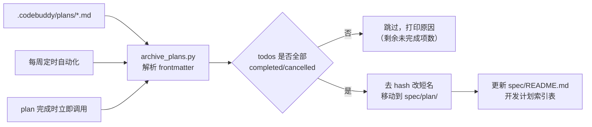

## 产品概述

建立"plan 完成后自动沉淀"的机制：CodeBuddy 生成的开发计划存于 `.codebuddy/plans/`，一旦执行完成，自动归档到仓库的 `spec/plan/` 并同步索引，使过程性文档变成可追溯的项目资产。

## 核心功能

1. **完成状态自动判定**：解析 plan 文件的 YAML frontmatter，依据 `todos` 中所有条目是否已进入终态（`completed` / `cancelled`）判定是否完成，不依赖文件名
2. **归档搬运**：把已完成的 plan 从 `.codebuddy/plans/` **移动**（按推荐值，非复制）到 `spec/plan/`，仓库内只保留一份，避免两处内容不同步
3. **文件名规范化**：去掉 `<name>_<8位hash>.md` 中的 hash 后缀，归档为 `<name>.md`
4. **索引同步**：自动在 `spec/README.md` 的「开发计划」索引表中新增或更新对应条目
5. **定时自动化**：建立每周一次的 CodeBuddy 定时自动化定期扫描归档；同时每次 plan 刚完成时立即执行一次，不等定时任务
6. **安全与幂等**：提供 `--dry-run` 预览；重复执行不会覆盖已有归档（同名但内容不同则自动加后缀），带 `(未完成)` 标记的文件不参与归档

## 边界说明

- Q1/Q2 用户未回答，按推荐值执行：**移动**、**去 hash 改短名 + 自动更新索引**；执行时可随时调整
- 本轮**不自动提交推送**，等用户确认后再定
- 脚本只处理 `.codebuddy/plans/` 下的 plan 文件，不涉及 `spec/prd/`、`docs/` 及 `.codebuddy/` 的其他内容

## 技术栈

- 语言：Python 3.11（`/opt/miniconda3/envs/robotworld/bin/python`）
- frontmatter 解析：优先 `PyYAML`（项目依赖已含 `pyyaml`），**缺失时降级为手写解析**，避免硬依赖
- 定时：`automation_update` 创建的 CodeBuddy 定时自动化（RRULE 每周）
- 目录约定：`tools/`（已有该目录，存放 `build_vendor_urdf.py` 等脚本）

## 实现方案

**策略**：写一个独立、可重复执行、带预览模式的归档脚本作为单一事实来源；定时自动化与"plan 完成时立即归档"都调用同一个脚本，避免两处逻辑漂移。

**关键技术决策与取舍**

| 决策 | 理由 |
| --- | --- |
| 完成状态以 `todos[].status` 为准，不看文件名 | 文件名里的 `(未完成)` 是人工标记，可能与实际状态不符；以结构化字段判定才可靠 |
| `cancelled` 与 `completed` 都算终态 | 二者都不会再变动，都应停止留在待办目录 |
| 采用**移动**而非复制 | 用户采纳推荐值；同一文档在两处会出现内容漂移，移动保证唯一来源 |
| 目标名与已有归档冲突时不覆盖 | 内容相同则跳过（幂等），不同则加 hash 后缀保全新内容，杜绝数据丢失 |
| `--dry-run` 先行 | 归档是移动操作，不可回滚（除非 git 还原），必须先预览确认判定结果正确 |
| PyYAML 做降级处理 | 计划先在脚本里 try 导入 yaml，失败时用简单的 frontmatter 行解析提取 status，保证脚本在任何环境都能跑 |


**性能与可靠性**

- plan 文件数量级为几十个，全量扫描开销可忽略；每次归档前才读写 `spec/README.md`
- 幂等性：源文件移走后自然不会重复处理；同名目标存在时按内容比对决定跳过或改名
- 主要风险是**误判导致未完成的 plan 被归档**，因此首轮必须 `--dry-run` 并由人工确认清单

## 执行要点

- frontmatter 位于文件首尾 `---` 之间；解析失败的文件应**跳过并告警**，不得删除
- `spec/README.md` 的「开发计划」表需按行定位（找表头 `| 文档 | 主题 | 状态 |`），在其后追加/更新数据行；找不到表头则告警退出，禁止盲目改写文件
- 主题文案取 `overview` 前若干字（超出加省略号），`overview` 为空时回退用 `name`
- 状态映射：全部 `completed` → `已完成`；含 `cancelled` → `部分终止`/`已终止`（按占比简化为：全 cancelled 记 `已废弃`，其余记 `已完成`）
- 归档时保留原文件内容（含 frontmatter），仅改文件名与位置，不重写正文
- 若某文件判为完成但文件名带 `(未完成)`，打印**告警**提醒人工核对，且归档后文件名需去掉该标记

## 架构设计



## 目录结构

```
RobotWorld/
├── tools/
│   └── archive_plans.py      # [NEW] 归档脚本。扫描 .codebuddy/plans 下的 plan 文件，
                              #       解析 YAML frontmatter 判定是否完成（todos 全为
                              #       completed/cancelled）；已完成的移动到 spec/plan/
                              #       并去掉文件名末尾的 hash 后缀；同步更新
                              #       spec/README.md 的「开发计划」索引表。
                              #       支持 --dry-run 预览；同名冲突时内容相同则跳过、
                              #       不同则加 hash 后缀保留；PyYAML 缺失时降级为手写解析
├── spec/
│   ├── README.md             # [MODIFY] 1) 新增「归档规则」小节，说明源目录、归档目录、
│   │                         #           判定依据与触发方式（定时任务 + 完成时立即执行）；
│   │                         #           2) 「开发计划」索引表由脚本自动增删 ingin
│   └── plan/                 # [MODIFY] 归档落点：新增若干 <name>.md（由 .codebuddy/plans
                              #          移入）；已有 _TEMPLATE.md 与 ui-refactor-and-macos-app.md
                              #          保持不动，且不参与自动处理
└── .codebuddy/plans/         # [移动源] 已完成的从此目录移出；未完成的（含带「未完成」
                              #          标记的两个）保持原地
```

## 关键代码结构

```python
def parse_frontmatter(path: str) -> dict:
    """读取 plan 文件的 YAML frontmatter。

    优先 yaml.safe_load；ImportError 时降级为手写行解析。
    解析失败或无 todos 字段时返回空 dict，由调用方跳过并告警。
    """


def is_completed(meta: dict) -> bool:
    """判定 plan 是否完成：todos 非空且全部处于终态。

    终态定义为 status ∈ {"completed", "cancelled"}。
    """


def clean_name(file_stem: str) -> str:
    """归档文件名规范：去掉末尾 _<8位hex> 与「(未完成)」标记。"""


def update_index(readme_path: str, doc_name: str, topic: str,
                 status: str) -> bool:
    """在 spec/README.md 的「开发计划」表中插入或更新一行。

    已存在同名文档则替换该行状态；找不到表头返回 False 且不改动文件。
    """
```

脚本主流程：`扫描 → 解析 → 判定 →（dry-run 打印/正式移动）→ 更新索引 → 输出统计报告`

## Agent Extensions

### Skill

- **evidence-driven-fix**
- 用途：归档属于不可逆的移动操作，按该技能的"先测量再判断"纪律，正式执行前必须 `--dry-run` 产出可读判定清单（哪些归档、哪些跳过及其原因），确认无误再落盘
- 预期结果：得到准确的完成/未完成判定清单，杜绝误归档；正式执行后可复跑验证幂等性