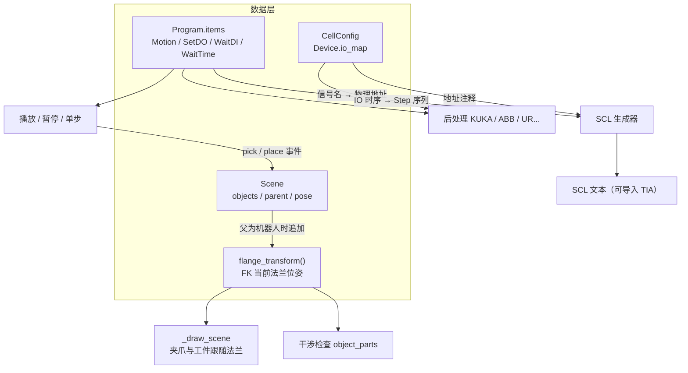

## 产品概述

为发布打造「零件抓取工作站」端到端 Demo：一个 KUKA 机器人 + 两指夹爪 + 工作台 + 料垛 + 输送线的完整工位，可在 GUI 中连贯演示离线编程全流程。

## 核心功能

覆盖用户指定的五个环节，形成一条完整的演示动线：

1. **模拟环境建立**：一键载入预置抓取工作站场景（机器人、底座、工作台、夹爪、料垛工件、输送线、围栏、控制柜），也可从组件库自行拖拽搭建
2. **控制系统配置**：把夹爪挂载到机器人法兰；配置机器人/PLC/夹具设备与 IO 地址映射，建立握手信号契约
3. **动作模拟**：按「接近点 → 抓取点 → 提升 → 放置点 → 撤离」三段式示教；播放时工件被夹爪吸附并随法兰运动，到放置位释放；支持暂停/单步，可跑干涉检查与节拍估算
4. **机器人程序生成**：选择 KUKA KRC4 / ABB RAPID 等目标，输出含抓取 IO 指令的程序代码
5. **PLC 程序生成**：输出西门子 **SCL** 单元控制逻辑，并**接入机器人程序中的真实 IO 时序**（信号名 + 工步），使 PLC 程序与机器人程序按同一套握手契约对接

## 边界

- 机器人模型沿用现有程序化 URDF（真机 CAD 属外部依赖，不阻塞发布）
- **PLC 输出锁定 SCL**：用户已确认保留 SCL，本轮**不新增阶梯图**。SCL 是西门子 TIA 唯一支持纯文本导入的外部源文件格式（LAD/FBD 为图形语言，无文本源文件，只能经 TIA Openness 导入版本相关的内部 XML）
- PLC 生成结果必须标注「未经真机/TIA 验证，下装前须核对 IO 地址与工艺步骤」
- 本轮聚焦抓取（pick & place），不涉及焊接、码垛等其他工艺

## 技术栈

- 语言：Python 3.11（`/opt/miniconda3/envs/robotworld/bin/python`）
- GUI：**PySide6**（务必注意，非 PyQt5）；无头验证需 `QT_QPA_PLATFORM=offscreen`
- 渲染：PyOpenGL 立即模式（`rw.py` 的 `GLWidget._draw_scene`）
- 后处理：Jinja2 模板 + `BasePostProcessor` 抽象基类
- 后处理目标：kuka / abb / ur / fanuc / yaskawa / estun / jaka（7 品牌）

## 实现方案

**核心洞察**：父子绑定基础设施已全部就位，本轮是"填空"而非"新建"。

已验证的现成能力（实测代码，非推测）：

| 已有 | 位置 |
| --- | --- |
| `SceneObject.parent` 字段 | `scene.py:62` |
| `world_transform()` 递归合成父变换 | `scene.py:277-293` |
| `Scene.add(..., parent=)` | `scene.py:200-237` |
| `remove()` 自动把子对象上挂到祖父 | `scene.py:250-256` |
| `Scene.to_dict()/from_dict()` JSON 序列化 | `scene.py:452-497` |
| `Robot.tool`（TCP 偏移），FK/IK 已互逆 | `robot.py:67-232` |
| 16 个参数化组件（含 `tool_gripper`、`pallet`、`conveyor`、`worktable`） | `components.py:473+` |
| `Step`/`default_steps()`/`generate_scl()`（安全联锁 + `CASE step OF` 步序） | `plc_scl.py` |


### 关键技术决策

| 决策 | 理由 |
| --- | --- |
| **挂载约定：父对象 == ROBOT_NAME 即"挂到法兰"** | 不引入新的数据字段，直接复用既有 `parent` 链；`world_transform` 只需在父为机器人时**追加当前法兰位姿**一处改动 |
| 法兰位姿由 `RobotKinematics.forward_kinematics(robot_joints_deg)` 求得 | `Scene` 已持有 `_kinematics` 与 `_robot_joints_deg`（`scene.py:344-346`），无需外部注入；渲染与干涉检查都走 `object_parts()`，改一处即全局生效 |
| **工件吸附复用同一套 parent 机制** | 抓取时把工件 `parent` 设为 ROBOT_NAME 即自动跟随法兰；放置时置 `None` 并按当前位姿落回世界。与抓手挂载共享实现，零额外成本 |
| **IO 指令与 Motion 并列进 `Program.items`** | `Program.motions` 保留为 property（过滤出 Motion），`TrajectoryPlanner` 等既有消费方完全不用改，向后兼容 |
| 信号用**逻辑名**（`gripper_close`），地址由 `Device.io_map` 在后处理期解析 | 保持与 `HANDSHAKE_SIGNALS` 契约一致；换 PLC 型号只改映射不改程序 |
| **PLC 只输出 SCL，不做阶梯图** | 用户确认保留 SCL。SCL 是唯一可直接导入 TIA 的纯文本路径；阶梯图需绑定 TIA 版本且必须装 TIA，风险高收益不确定 |
| **SCL 接入 Program 真实 IO 时序** | 现有 `default_steps()` 是写死的五步骨架，与本轮示教出的实际抓取动作无关。接入后 PLC 步序直接由机器人程序推导，两边不会脱节 |
| 预置场景用 `Scene.from_dict()` + JSON | 序列化格式已存在，无需设计新格式 |


### 性能与可靠性

- 夹爪/工件跟随法兰：`world_transform` 每帧递归一次（深度 ≤ 3），开销可忽略；法兰位姿由 FK 现算，6 轴 IK/FK 为既有实现
- 干涉检查已用完整运动树（`scene.py:384` 注释），挂载件自动纳入，无需额外注册
- 风险点：`world_transform` 是递归函数，改造时必须保留 `obj.parent is None` 的终止条件，避免机器人作为自身父级造成无限递归

## 执行要点

- **先跑探针再改**：沿用 `evidence-driven-fix` 纪律，用 `~/.codebuddy/skills/evidence-driven-fix/scripts/qt_widget_probe.py` 无头量测（挂载后夹爪世界坐标是否随关节变化、`Program.items` 组成、SCL 输出是否含真实 IO 信号）
- 改 `world_transform` 时**只加"父为机器人则追加法兰"这一个分支**，不动其余逻辑，避免影响工作台/围栏等静态对象
- `Scene.add` 挂载前校验父对象存在（已有 `ValueError`），并拒绝把机器人自己作为子对象
- IO 指令输出前必须能从 `CellConfig` 解析到物理地址；解析不到时**输出带 TODO 注释的占位**并告警，绝不静默生成错误地址（参照 `PostProcessError` 的既有严格约定）
- SCL 接入 IO 时序时保留既有安全联锁与 `default_steps()` 回退：Program 无 IO 时仍能用默认骨架生成，不退化成报错
- 每项改完立刻用同一探针复测同一指标，不攒到最后

## 架构设计



## 目录结构

```
RobotWorld/
├── python/orolp/
│   ├── world/
│   │   ├── scene.py          # [MODIFY] 1) 新增 flange_transform()：由 _kinematics 与
│   │   │                     #           _robot_joints_deg 求当前法兰 4x4（米→毫米）；
│   │   │                     #           2) world_transform() 增加分支：父对象为
│   │   │                     #           ROBOT_NAME 时在其后追加法兰位姿；
│   │   │                     #           3) 新增 attach(name, parent) / detach(name) 便捷方法，
│   │   │                     #           含"禁止把机器人设为自身子对象"校验；
│   │   │                     #           4) 确认 robot_urdf 已纳入 to_dict/from_dict
│   │   └── panel.py          # [MODIFY] 场景树/属性面板增加「挂载到」下拉：可挂到机器人
│   │                         #           法兰或任一对象；卸载即解除 parent
│   ├── program.py            # [MODIFY] 新增 SetDO / WaitDI / WaitTime 数据类；
│   │                         #           Program 增加 items 列表（Motion 与 IO 指令并列），
│   │                         #           motions 降级为 property 过滤 Motion 以保向后兼容
│   ├── pickplace.py          # [NEW] 抓取工艺：点位类型枚举（approach/pick/lift/place/retract）、
│   │                         #           由示教点位序列自动插入 IO 指令的规则、
│   │                         #           播放期工件挂载（parent=ROBOT_NAME）与释放（detach）
│   ├── post/
│   │   ├── base.py           # [MODIFY] BasePostProcessor 新增 IO 格式化接口（format_setdo /
│   │   │                     #           format_waitdi / format_waittime），消费既有
│   │   │                     #           PostConfig.io_format 字段（目前从未被使用）
│   │   ├── kuka.py           # [MODIFY] 输出 $OUT / WAIT FOR $IN / WAIT SEC
│   │   ├── abb.py            # [MODIFY] 输出 SetDO / WaitDI / WaitTime
│   │   └── ur.py             # [MODIFY] 输出 set_digital_out / wait_digital_in / sleep
│   └── plc_scl.py            # [MODIFY] 1) 新增 steps_from_program(program, cell)：由
│                             #           Program.items 的 IO 时序推导 Step 序列；
│                             #           2) generate_scl() 支持传入该序列，Program 无 IO 时
│                             #           回退 default_steps()；保留既有安全联锁与地址注释
├── assets/cells/
│   └── pick_place_kuka.json  # [NEW] 预置抓取工作站场景（Scene.from_dict 格式）：
│                             #           KR16 机器人 + 底座 + 工作台 + 两指夹爪（挂法兰）
│                             #           + 码垛料垛工件 + 皮带输送线 + 围栏 + 控制柜
└── rw.py                     # [MODIFY] 1) 预置场景一键载入菜单项；
                              #           2) 示教点位类型标记（接近/抓取/提升/放置/撤离）；
                              #           3) 控制条加暂停/单步按钮；
                              #           4) 状态栏加常驻区（节拍/干涉/IO/报错）；
                              #           5) PLC 生成改为传入当前 Program，使 SCL 反映真实 IO
```

## 关键代码结构

```python
# ---- orolp/program.py：IO 指令与 Program 容器 ----
@dataclass
class SetDO:
    """置位数字输出。signal 用逻辑名（如 "gripper_close"）。"""
    signal: str
    value: bool

@dataclass
class WaitDI:
    """等待数字输入达到期望值。timeout<=0 表示无限等待。"""
    signal: str
    value: bool = True
    timeout: float = 0.0

@dataclass
class WaitTime:
    """纯延时（秒）。"""
    seconds: float

# Program 增加 items；motions 退化为 property：
#   @property
#   def motions(self) -> List[Motion]:
#       return [i for i in self.items if isinstance(i, Motion)]
# 使 TrajectoryPlanner 等既有消费方无需改动。
```

```python
# ---- orolp/world/scene.py：法兰跟随 ----
def flange_transform(self) -> np.ndarray:
    """当前法兰在世界系下的 4x4 变换（毫米）。

    由 _kinematics 与 _robot_joints_deg 正向求解；无机器人时返回单位阵。
    """

def attach(self, name: str, parent: str | None) -> None:
    """把对象挂到父对象；parent 为 ROBOT_NAME 即挂到法兰。

    拒绝把机器人自身或自身祖先设为父，避免 world_transform 无限递归。
    """
```

```python
# ---- orolp/plc_scl.py：由机器人程序推导 PLC 步序 ----
def steps_from_program(program, cell: "CellConfig") -> List[Step]:
    """把 Program.items 的 IO 时序翻译为 PLC 工步。

    遍历 items：遇 SetDO 记录该步输出；遇 WaitDI 作为该步的等待条件；
    遇 WaitTime 作为延时步。Program 无 IO 指令时返回空列表，由
    generate_scl 回退到 default_steps()。

    信号一律用 HANDSHAKE_SIGNALS 中的逻辑名，物理地址留待 generate_scl
    经 Device.io_map 解析成注释。
    """
```

## Agent Extensions

### Skill

- **evidence-driven-fix**
- 用途：本任务横跨挂载机制、IO 指令层、抓取仿真、后处理、SCL 生成、GUI 集成六处改动，互为依赖，任一处出错都会表现为"演示跑不通"却难以定位。按该技能纪律，每项实施前先列可证伪猜想并用无头探针量测（挂载后夹爪世界坐标是否随关节变化、`Program.items` 组成、SCL 是否含真实 IO 信号），只改被证据锁定的那一处，再用同一手段复测
- 预期结果：每一步都有可比对的前后量化指标，避免像之前"参数面板消失"那样连错三次；最终五项演示环节全部实测通过而非仅代码审查通过