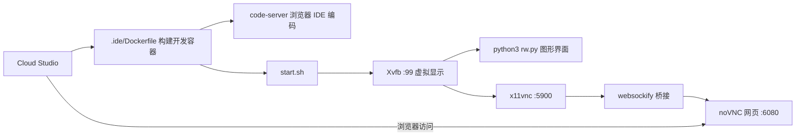

## 用户需求

更新 `.ide/Dockerfile`，把 Cloud Studio 通用开发容器升级为「既能云端写代码、又能在浏览器里直接看到并操作 RobotWorld GUI」的网页试运行环境；同时修正 `.cnb.yml` 中 vscode 段错误的 `launch: node index.js`（仓库无 index.js、镜像也无 Python）。

## 产品概述

将现有基于 `node:20` 的通用模板改造为 RobotWorld 云端开发+网页试运行容器：保留 code-server（浏览器版 VS Code）与 CodeBuddy Code 编码环境，叠加 Python 运行时、RobotWorld 核心/GUI 依赖，用 xvfb 虚拟显示启动 `rw.py`，再经 x11vnc + websockify + noVNC 把虚拟桌面投到网页，使开发者在浏览器中即可查看并操作 RobotWorld 图形界面，方便网站浏览测试。

## 核心功能

- 云端编码：code-server + CodeBuddy Code（保留原 node 工具链）
- Python 运行时与 RobotWorld 依赖（含 PySide6/PyOpenGL GUI 库）
- xvfb 虚拟显示下启动 `rw.py` 图形界面
- noVNC 网页暴露 GUI：x11vnc 采集桌面，websockify 桥接至 noVNC HTTP 端口
- `.cnb.yml` vscode `launch` 改为启动上述试运行栈，使 Cloud Studio 预览即 RobotWorld GUI 网页

## 技术栈选择

- 容器：Docker（单阶段，基于 `node:20` Debian 基础镜像）
- 包管理：apt（系统库/工具）+ pip（Python 依赖）
- 虚拟显示：xvfb（Xvfb）
- 远程桌面投屏：x11vnc（VNC 服务）+ websockify（VNC↔WebSocket 桥接）+ novnc（网页 VNC 客户端，Debian `novnc` 包提供 `/usr/share/novnc`）
- 编码环境：code-server + 插件、@tencent-ai/codebuddy-code（保留）
- 编排：Bash 启动脚本 `.ide/start.sh`

## 实现方案

保留 `node:20` 基础镜像（code-server / CodeBuddy / 插件生态均依赖 npm，避免改 python 基础再补 node），在其上用 apt 叠加 Python3.11 + 编译工具 + Qt xcb 运行库 + xvfb/x11vnc/websockify/novnc，再用 pip 装 RobotWorld 依赖；通过 `.ide/start.sh` 按顺序拉起「Xvfb :99 → `DISPLAY=:99 python3 rw.py` → x11vnc(:99) → websockify(桥接至 noVNC :6080)」，`.cnb.yml` 的 `launch` 调用该脚本。

关键决策与权衡：

- 基础镜像沿用 `node:20`：最小化对原编码环境的破坏，CodeBuddy CLI 与 code-server 插件无需重装；代价是镜像体积偏大（可接受，属开发容器）。
- `PYTHONPATH=/app/python`：与根 `Dockerfile` 一致，保证 `import orolp` 可用（pyproject 中 `package-dir={"orolp"="python/orolp"}`）。
- 仅装 `gui` 可选依赖（PySide6/PyOpenGL）+ 全套 Qt xcb 运行库，规避「could not load Qt platform plugin "xcb"」；核心 API 不依赖 Qt，仅 `rw.py` 需要。
- 跳过 C++ 扩展 `orolp_core` 编译（`__init__` 已 try/except 容错）。

## 实现要点

- Qt xcb 运行库需齐全：`libgl1 libegl1 libglib2.0-0 libxkbcommon0 libdbus-1-3 libfontconfig1 libxrender1 libx11-xcb1 libxcb-xinerama0 libxcb-cursor0 libxcb-icccm4 libxcb-keysyms1 libxcb-image0 libxcb-shm0 libxcb-randr0 libxcb-render-util0 libxcb-xkb1 libxkbcommon-x11-0`。
- websockify 用 `--web=/usr/share/novnc` 挂载 noVNC 网页，监听 `6080`，后端指向 `localhost:5900`（x11vnc）。
- `.cnb.yml` 保留 `onlyPreview: true` + `daemon: true`；`launch` 改为前台运行 `start.sh`（持续存活即预览可用）。
- 不改动根 `Dockerfile`（产品镜像）与 main/tag_push 流水线。

## 架构设计



## 目录结构

```
.ide/
├── Dockerfile   # [MODIFY] 在 node:20 模板上叠加 Python3.11、RobotWorld 依赖(PySide6/PyOpenGL)、
│               #          xvfb/x11vnc/websockify/novnc；保留 code-server 与 CodeBuddy；CMD 调 start.sh
└── start.sh     # [NEW] 编排 Xvfb→rw.py→x11vnc→websockify/noVNC 的启动脚本(需可执行)
.cnb.yml         # [MODIFY] vscode 段 launch: node index.js → launch: bash .ide/start.sh
```

## 关键代码结构

`.ide/start.sh`（核心编排，需 `chmod +x`）：

```
#!/usr/bin/env bash
set -e
Xvfb :99 -screen 0 1280x800x24 >/dev/null 2>&1 &
sleep 2
DISPLAY=:99 python3 /app/rw.py >/tmp/rw.log 2>&1 &
sleep 3
x11vnc -display :99 -nopw -forever -rfbport 5900 >/tmp/x11vnc.log 2>&1 &
exec websockify --web=/usr/share/novnc 6080 localhost:5900
```

## Agent Extensions

### Integration

- **cloudStudio**
- Purpose: 将改造后的 `.ide/Dockerfile` 开发容器部署到 Cloud Studio，实际拉起云端 IDE 与 noVNC 预览，验证 `.cnb.yml` vscode 段配置生效。
- Expected outcome: 开发容器构建成功，浏览器中能打开 code-server 编辑代码，且 noVNC 端口可显示并操作 RobotWorld GUI，确认 `launch` 改正生效、无启动报错。