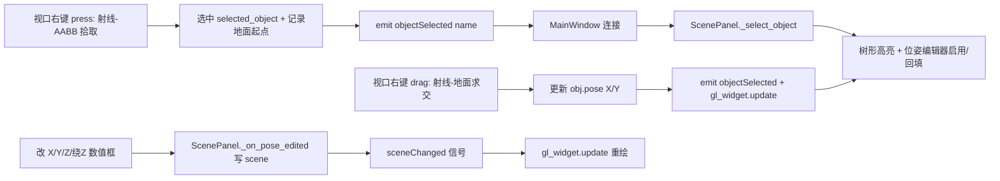

## 用户需求

在 RoboWorld 的 3D 视口中，通过鼠标交互选中并移动工作单元里的场景对象（工作台、控制柜、机器人底座等），并能在左侧「选中对象位姿」编辑器中实时编辑位姿。

## 产品概述

当前左侧 ScenePanel 的树形列表点击可选中对象并编辑位姿，但 3D 视口（GLWidget）仅支持左键旋转视角与滚轮缩放，右键无任何拾取逻辑。需补齐「视口右键点选对象 → 列表高亮 → 按住右键在水平地面拖动移动 → 数值框双向同步」的交互闭环。

## 核心功能

- 右键拾取：在视口中右键点击对象，根据相机参数反推射线，对场景对象做包围盒求交，选中最近对象并在视口描边高亮。
- 右键拖动移动：选中对象后按住右键在水平地面（XY 平面）拖动，实时改变对象 X/Y 坐标；Z 高度与绕 Z 旋转仍由左侧数值框编辑。
- 双向同步：视口拖动时左侧 X/Y 数值框实时刷新；在数值框改 X/Y/Z/绕Z 时视口实时重绘。
- 视角操作不变：左键继续用于旋转视角，与右键拖动两两互不干扰。

## 技术栈

- GUI：PySide6（`QOpenGLWidget` / 信号槽）
- 数值与几何：numpy；复用现有 `orolp.world.geometry.prim_aabb`（基本体世界 AABB，毫米）
- 场景数据：`orolp.world.scene.Scene.object_parts(name)`（世界系 Part 列表，毫米）、`Scene.world_transform(name)`
- 位姿：`orolp.pose.Pose.from_xyz_rpy(x, y, z, roll, pitch, yaw)`

## 实现方案

### 总体策略

在 `GLWidget` 内新增「右键 → 射线拾取/选中 → 右键拖动沿地面平面移动 → 发射选中信号」链路，复用 `paintGL` 中已构造的相机模型（eye 由 `camera_dist/az/el/view_center` 推导）与现有 `geometry.prim_aabb`、`Pose` API。主窗口把 `objectSelected` 信号接到 `ScenePanel._select_object`，直接复用现有位姿编辑与数值回填逻辑，无需改动 `ScenePanel` 公共 API。

### 关键技术决策

1. **射线反推（_ray_from_mouse）**：用与 `paintGL` 完全一致的相机公式重建 `eye` 与 lookAt 基、`fov=45` 的 frustum 投影矩阵，取鼠标 NDC 坐标经 `(P·V)⁻¹` unproject 出近/远平面世界点；射线原点=eye，方向=远平面点-eye。全程在**米**制下运算（相机全为米）。
2. **拾取（_pick_object）**：遍历 `scene.objects`，对每个对象用 `object_parts` + `prim_aabb` 合并出世界 AABB，平移乘 `MM_TO_M=0.001` 换算到米；对所有对象做射线-AABB slab 求交，取 `t>0` 最小者；无命中返回 `None`。理由：AABB 粗筛对参数化基本体场景足够精确，零新增依赖、O(对象数×零件数) 极低开销，仅在右键事件触发。
3. **右键拖动移动**：`mouseMoveEvent` 中若 `event.buttons() & Qt.RightButton` 且 `self.selected_object` 有效，取当前鼠标射线与地面平面 `Z = obj.worldZ_m` 的交点 `cur`，平移量 `delta_m = cur - self.drag_start`；新世界平移(mm) = 起始世界平移(mm) + `delta_m[0:2]*1000`；保持原绕Z（由对象位姿矩阵 `atan2(R[1,0], R[0,0])` 取角度），写 `obj.pose = Pose.from_xyz_rpy(...)`；`self.update()` 重绘并 `emit objectSelected(name)` 刷新数值框。
4. **双向同步**：拖动过程每帧 `emit objectSelected(name)`，触发 `ScenePanel._select_object` → `_on_tree_selected`（带 `_updating` 防回环）回填并启用 X/Y/Z/绕Z 数值框；数值框改动经现有 `_on_pose_edited` 写回 `scene` 并发 `sceneChanged`，主窗口已连接 `sceneChanged → gl_widget.update` 重绘，链路天然闭环。
5. **高亮**：`GLWidget` 记录 `self.selected_object`，`paintGL` 中对选中对象复用与 `_last_collisions` 一致的红色线框描边（`_highlight_object` 思路，独立标志位，不新增绘制类型）。
6. **信号接线**：`GLWidget.objectSelected = QtCore.Signal(str)`；主窗口 `setup_ui` 末尾 `self.gl_widget.objectSelected.connect(self.scene_panel._select_object)`。

### 性能与可靠性

- 拾取与拖动仅在右键事件触发，非逐帧，开销可忽略。
- 单位统一：场景/几何为毫米、视口为米，统一用 `MM_TO_M=0.001` 换算，避免错位。
- 容错：`scene` 为 `None`、无对象、未命中时 `_pick_object` 返回 `None` 不报错；`prim_aabb` 已覆盖 box/cylinder/sphere。
- 拖动用「起点记录」方式计算增量，避免逐帧从世界变换重算导致的二次叠加误差。

## 架构设计



## 目录结构

```
/Users/jayhan/RoboWorld/
└── olp.py   # [MODIFY] 视口 GLWidget：新增 objectSelected 信号、_ray_from_mouse、
             #          _ray_plane_z 辅助方法、_pick_object 拾取；mousePressEvent 增加
             #          Qt.RightButton 选中分支并记下拖动起点；mouseMoveEvent 增加右键
             #          拖动移动对象（XY 地面平面）；paintGL 对 self.selected_object
             #          描边高亮。主窗口 setup_ui：连接 objectSelected → scene_panel._select_object。
```

## 关键代码结构

```python
class GLWidget(QtOpenGLWidgets.QOpenGLWidget):
    objectSelected = QtCore.Signal(str)   # 右键拾取/拖动时发射对象名（未命中不发射）

    def _ray_from_mouse(self, x: int, y: int) -> Tuple[np.ndarray, np.ndarray]:
        """返回 (origin_m, dir_m)：世界系米制射线原点与单位方向。"""

    def _ray_plane_z(self, origin_m, dir_m, z_m) -> Optional[np.ndarray]:
        """射线与水平面 z=z_m 的交点（米）；平行或无交点返回 None。"""

    def _pick_object(self, x: int, y: int) -> Optional[str]:
        """射线-AABB 求交，返回最近场景对象名；无命中返回 None。"""
```