## 用户需求

在 RoboWorld 的 3D 视口中通过**右键点击**选中场景对象（工作台、控制柜、机器人底座等），并能在左侧「选中对象位姿」编辑器中实时移动与旋转该对象。

## 产品概述

当前左侧场景面板（ScenePanel）的树形列表点击可选中对象并编辑位姿，但 3D 视口（GLWidget）仅支持左键旋转与滚轮缩放，右键无任何拾取逻辑。需补齐「视口右键点选对象 → 列表高亮 → 数值编辑即时生效」的交互闭环。

## 核心功能

- 视口右键拾取：根据当前相机参数由鼠标像素坐标反推世界坐标系射线，对场景对象做射线-包围盒求交，选中最近的对象。
- 选中同步：拾取结果同步到 ScenePanel 树形选择，自动激活「选中对象位姿」编辑器（X / Y / Z / 绕 Z）。
- 实时编辑：修改位姿数值后，视口实时刷新对象位置与朝向。
- 可视反馈：视口中选中对象以描边高亮，便于确认当前选中目标。

## 技术栈

- GUI：PySide6（`QOpenGLWidget` / 信号槽）
- 数值与几何：numpy；复用现有 `orolp.world.geometry.prim_aabb`（基本体世界 AABB，毫米）
- 场景数据：`orolp.world.scene.Scene.object_parts(name)`（世界系 Part 列表，毫米）

## 实现方案

### 总体策略

在视口 `GLWidget` 内新增一条「右键 → 射线拾取 → 发射选中信号」的链路，复用 `paintGL` 中已构造的相机模型（eye 由 `camera_dist/az/el/view_center` 推导）与 `geometry.prim_aabb`。主窗口把该信号接到 `ScenePanel._select_object(name)`，直接复用现有位姿编辑逻辑，避免改动 ScenePanel 公共 API。

### 关键技术决策

1. **射线反推（_ray_from_mouse）**：用与 `paintGL` 完全一致的相机公式重建 eye 与 lookAt 基，按视口宽高与 `fov=45` 的 frustum 构造投影矩阵，取鼠标 NDC 坐标经 `投影·视图` 逆矩阵 unproject 出近/远平面世界点，射线原点=eye，方向=远平面点-eye。统一在**米**制下运算（相机全为米）。
2. **拾取（_pick_object）**：遍历 `scene.objects`，对每个对象用 `object_parts` + `prim_aabb` 合并出世界 AABB，平移分量乘 `MM_TO_M=0.001` 换算到米；对所有对象做射线-AABB slab 求交，取 `t>0` 中最小者。无命中返回 `None`。

- 理由：AABB 粗筛对参数化基本体场景足够精确，且零新增依赖、O(对象数×零件数) 极低开销，仅在右键点击时触发，不影响逐帧渲染。

3. **信号接线**：新增 `GLWidget.objectSelected = QtCore.Signal(str)`；主窗口 `setup_ui` 末尾 `gl_widget.objectSelected.connect(scene_panel._select_object)`。
4. **高亮（可选增强）**：`GLWidget` 记录 `self.selected_object`，`paintGL` 中对选中对象套用与 `_last_collisions` 一致的红色线框描边，提升反馈（不新增绘制路径类型）。

### 性能与可靠性

- 拾取只在 `mousePressEvent` 右键触发，非逐帧，开销可忽略。
- 单位统一：场景/几何为毫米，视口为米，求交全程在米制，避免错位。
- 容错：`scene` 为 `None` 或无对象时 `_pick_object` 直接返回 `None`，不报错；`prim_aabb` 已对 box/cylinder/sphere 覆盖，无需扩展。

## 实现要点

- 不破坏 `ScenePanel` 现有树形选择与位姿编辑。
- 复用 `prim_aabb` 与 `_draw_scene` 已有变换逻辑（`part.transform` 平移乘 `MM_TO_M`），保持求交与渲染一致。
- 右键分支与左键拖拽互斥，互不干扰。

## 架构设计

```mermaid
flowchart LR
    A[视口右键 mousePressEvent] --> B[_pick_object: 射线-AABB 求交]
    B --> C[objectSelected name 信号]
    C --> D[MainWindow 连接]
    D --> E[ScenePanel._select_object]
    E --> F[树形高亮 + 位姿编辑器启用]
    F --> G[用户改 X/Y/Z/绕Z]
    G --> H[ScenePanel._on_pose_edited 改 scene]
    H --> I[sceneChanged 信号]
    I --> J[gl_widget.update 重绘]
```



## 目录结构

```
/Users/jayhan/RoboWorld/
└── olp.py   # [MODIFY] 视口 GLWidget：新增 objectSelected 信号、_ray_from_mouse、
             #          _pick_object 方法；mousePressEvent 增加 Qt.RightButton 分支；
             #          paintGL 对 self.selected_object 描边高亮。
             #          主窗口 setup_ui：连接 gl_widget.objectSelected → scene_panel._select_object。
```

## 关键代码结构

```python
class GLWidget(QtOpenGLWidgets.QOpenGLWidget):
    objectSelected = QtCore.Signal(str)   # 右键拾取到的对象名（未命中不发射）

    def _ray_from_mouse(self, x: int, y: int) -> Tuple[np.ndarray, np.ndarray]:
        """返回 (origin_m, dir_m)：世界系米制射线原点与单位方向。"""

    def _pick_object(self, x: int, y: int) -> Optional[str]:
        """射线-AABB 求交，返回最近场景对象名；无命中返回 None。"""
```