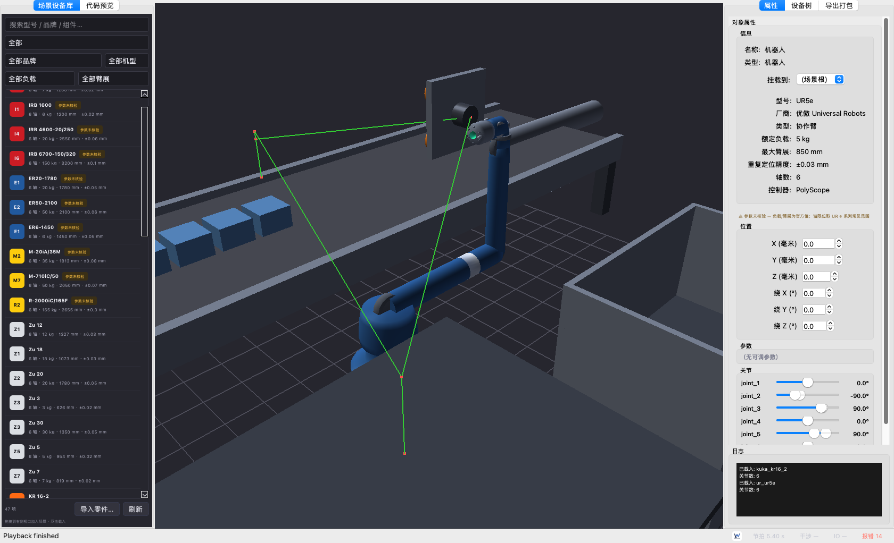
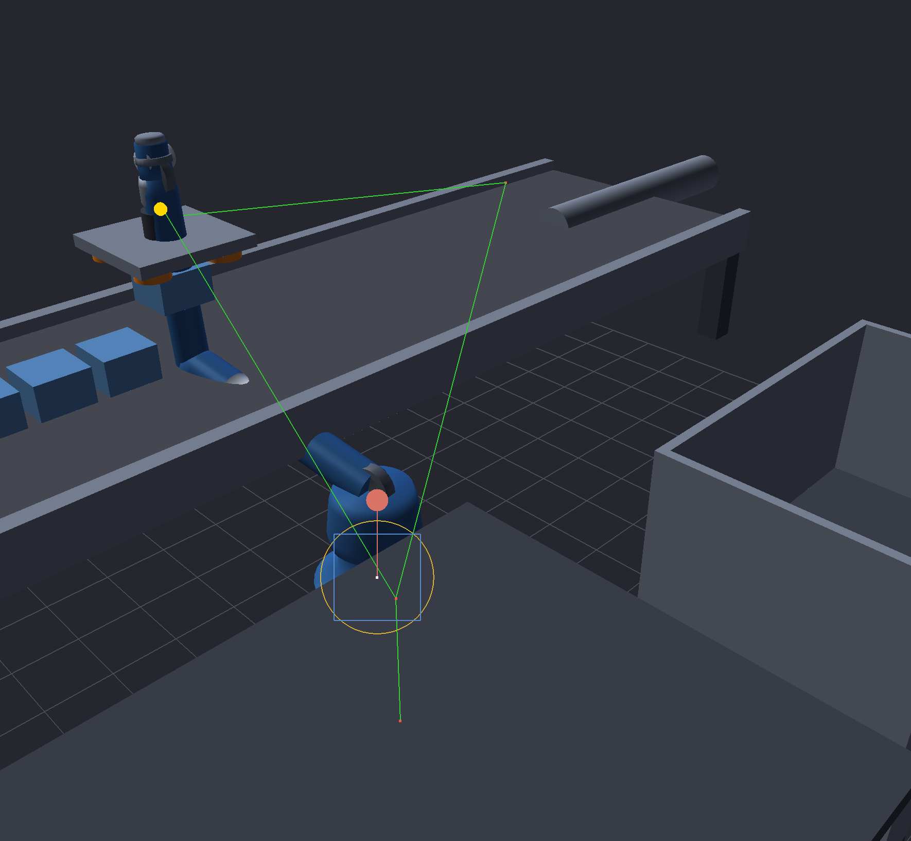
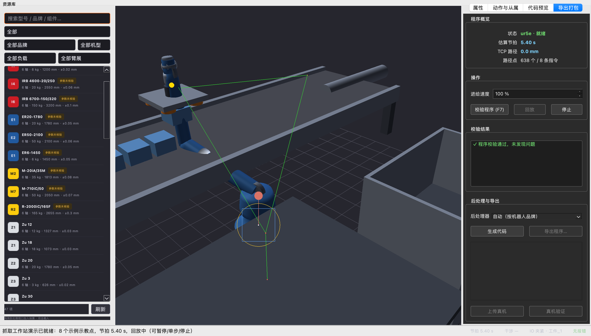

# RobotWorld

[](https://opensource.org/licenses/Apache-2.0)
[](https://python.org)
[](#开发进展)
[](#安装与快速开始)

**开源机器人编程与仿真平台**

一个面向工业机器人的开放、可扩展、社区驱动的生态，基于开放标准（URDF）、透明算法与社区维护的后处理器库构建。RobotWorld 不止于离线编程（OLP）：它将机器人建模、轨迹规划、仿真与代码生成统一到一条可审计的工具链中，作为 RoboDK / Robotmaster / DELMIA 等封闭生态的免费替代方案。

> **愿景**：通过开放标准降低工业机器人编程与仿真的门槛，让整个工具链开放、可审计、可改造、可学习，使每个人都能用上机器人编程与仿真。

[📖 后处理器开发指南](docs/post_dev_guide.md) · [🛠 厂商 CAD 接入](docs/VENDOR_CAD_SETUP.md) · [📋 需求与计划 / PRD·Plan](docs/SPECS.md)

---

## ✨ 开发进展

`main` 最新提交的实际状况快照。测试与模型库数据以当前代码为准。

| 模块 | 状态 | 当前可用能力 |
|---|---|---|
| **机器人模型库** | ✅ 28 个型号 | UR / KUKA / ABB / FANUC / Estun / JAKA / 汇川；程序化生成 URDF + 7 个 JAKA 真机 CAD（厂商 STEP 转网格） |
| **离线编程 API** | ✅ 完成 | 链式 `Robot.moveJ / moveL / moveC / moveSpline`；规划器轨迹展开；节拍估算；可达/限位校验 |
| **后处理器** | ✅ 7 个品牌 | Jinja2 模板：`ur_polyscope` / `kuka_krc4` / `abb_irc5` / `fanuc_r30ib` / `estun_er` / `jaka_zu` / `huichuan_inoteach`；SPLINE 自动降级为 PTP/LIN |
| **代码上传 (`link.py`)** | ✅ 完成 | `ControllerLink` 抽象 — `FileLink`（离线导出 + manifest.json）、`SimLink`（进程内运动学回读）、`SocketLink`（**真机**：TCP + 单行 JSON 协议，v1.0.5）；真机侧只需一段同协议转发，上层 deploy/debug/孪生零改动 |
| **在线调试 (`debug.py`)** | ✅ 完成 | `DebugSession`：单步/连续播放、回读实际位姿、与规划值偏差（mm + deg）、示教 jog |
| **运动学** | ✅ 纯 Python | FK / IK / 雅可比回退（C++ 核心可选）；807 个单元测试与回归测试通过 |
| **3D GUI (`app.py`)** | ✅ 完成 | PySide6 + OpenGL 视口；左「资源库」+ 右「属性 / 动作与从属 / 代码预览 / 导出打包」多面板；关节滑块、对象位姿与参数编辑、路径代码编辑器、场景树与 OLP |
| **工作单元模板** | ✅ S1 完成 | `orolp.world.templates`：一键抓取工作站（UR5e + 带 TCP 的真空夹爪 + 输送带/料箱/托盘 + 4 个零件）；布局按内置 UR5e 模型做可达性标定（2026-09-13）；可加载 JSON `examples/assets/grasping_workstation.json`；演示站点：`tools/build_web_site.py` → deploy/web |
| **工艺 IO 指令** | ✅ S2 完成 | 链式 `setDO` / `waitDI` / `waitTime` / `gripper("open"/"close")`，作用于 Program 与 builder（互锁信号 + 限幅反馈等待）；品牌 IO 语法：UR `set_digital_out`、KUKA `$OUT`、ABB `SetDO`、FANUC `DO[n]=ON`；未映射信号 → 显式 `TODO`，绝不编造地址 |
| **抓取动画（工件跟随）** | ✅ S3 完成 | 程序级回放驱动场景：`orolp.world.animation` 将 `gripper()` 指令映射到轨迹时间线（`GraspAnimator`）；夹爪闭合时工件吸附到法兰（保持世界位姿）并跟随 TCP，张开时停留在释放位置；ProgramPanel 在插值回放期间发出夹爪状态变化，示教的 PICK/PLACE 点自动将 `gripper()` 插入程序（回放与代码生成共用同一份定义） |
| **一键工作站演示** | ✅ S4 完成 | 文件菜单「抓取工作站演示」：构建模板场景、将 UR5e 载入视口、通过 TCP 感知的 IK 生成 8 点五抓循环演示程序（`orolp.world.demo`，可无头测试），送入同一示教路径管线，自动校验（节拍显示在状态栏）并自动开始回放（含工件吸附/释放） |
| **演示 showcase 包** | ✅ S5 完成 | 一键无头 showcase `examples/grasping_workstation_demo.py`（模板 → IK 演示点 → 夹爪 IO → 校验 + 节拍 → UR/KUKA/ABB/FANUC 代码生成）；`docs/screenshots/` 下 3 张抓取工作站 GUI 截图；截图工具 `tools/capture_grasp_screenshots.py` |
| **场景 / 碰撞** | ✅ v0.2.1 完成 | 连杆级碰撞检测（`orolp.collision`）：基于每连杆/每物体几何的宽相位关节 AABB → SAT 窄相位；机器人-环境 **和** 连杆-连杆自碰撞（相邻关节与固定刚性对豁免）；命中可定位连杆、零件、首次发生时间与运动索引（“哪一段撞到哪个物体”）；规划器逐轨迹点检查；视口将碰撞连杆/物体标红；接近奇异点时给出雅可比条件数软告警 |
| **速度/加速度规划** | ✅ v0.2.2 完成 | moveJ/moveL 梯形与 cosine S 曲线速度规划（`TrajectoryPlanner(profile="scurve")`，默认梯形节拍零回归）；`Waypoint.velocity/acceleration` 差分填充 + 轴限幅校核；节拍报表逐指令明细与占比；`Motion` 速度/加速度覆盖进 UR/KUKA/ABB/FANUC 出码 |
| **GUI 轨迹编辑器** | ✅ v0.2.4 完成 | 导出打包面板内直接编辑路点：插入（复制源点）/删除/上下移、双击或对话框手填关节角（度）与逐点运动类型（moveJ/moveL，moveL 按示教点 FK 位姿走直线插补）；校验后路点实时着色（错误红/警告橙/正常绿）并携带逐指令节拍；一键导出按品牌扩展名落盘（UR `.script` / KUKA `.src` / ABB `.mod`…，含 manifest 清单）；编辑改动自动回写路径代码编辑器，两条通路数据一致 |
| **动力学/力矩校验** | ✅ v0.3.1 完成 | `orolp.dynamics`：惯性参数双轨（URDF `<inertial>` 自动解析 + `set_link_inertial` 手动录入 + `set_payload` 末端负载，平行轴定理合并）；世界系牛顿-欧拉逆动力学（重力/离心/科氏项，fixed 末端 link 并入主链）；校验逐路点算关节力矩与机械功率——峰值超额定报错（GUI 路点行标红）、达 85% 预警；报表含逐轴峰值/额定力矩表与功率峰值/均值 |
| **STEP/CAM 轨迹生成** | ✅ v0.3.2 完成 | `orolp.cam`：STEP/IGES 导入 → 拓扑边离散（弦高容差可控，整圆焊缝/闭合回路完整保留）→ 端点共点串链提取焊缝/轮廓（闭合独立成链、按长度/闭合过滤）；`path_to_program` 转角检测 + 平滑段 moveC 按累计转角 ≤120° 分片（防整圆指令）+ 转角/短段 moveL，闭合路径环形分段，`z_lift` 法向抬高 + 固定焊炬姿态；`load_ply`（ASCII/二进制）+ `scan_deviation` 扫描点云偏差比对（max/mean/rms + 最差点定位）；CLI `tools/cam_path.py`（seams/path/deviation）；CAD 通道依赖可选的 `cadquery-ocp` |
| **焊接/喷涂工艺** | ✅ v0.3.3 完成 | `orolp.process` 工艺模板库：`WeldProcess`（电流/电压/送丝/保护气/预流后流/起弧反馈超时）+ `SprayProcess`（流量/扇幅/雾化压力）可配模板，YAML 叠加载入/导出（换工艺改模板不改程序）；链式 `arc_start/arc_end/spray_on/spray_off`（实例/模板名/默认三路解析）；FANUC 出原生 `ARCON AC= V=` / `ARCOFF`，UR/KUKA/ABB 降级 SetDO 语法 + 工艺参数注释；`waitDI` 边沿触发（rising/falling）语义，无原生指令处强制留 TODO 不静默降级 |
| **标定与手眼视觉** | ✅ v0.3.4 完成 | `orolp.calibration`：TCP **4 点法**（最小二乘解工具中心偏移 + 残差质量判据）与 **6 点法**（沿工具 +X/+Z 触碰补方向）；**基坐标/用户坐标系 3 点法**（Gram-Schmidt 正交化）与任意点对 **Kabsch 配准**；**手眼标定** `A·X = X·B`（Kronecker 线性化 + SVD 投影，符号歧义双解择优）支持 eye-in-hand / eye-to-hand，并给外参误差与方程残差；**相机模型 + 像素→抓取位姿**（内参/射线/支承面求交）打通相机触发抓取；`CalibrationSet` 打包 JSON、`apply_to_robot()` 写回仿真、`write_urdf()` 把标定 TCP 写进 URDF 副本（原地更新既有 `tcp` 关节，幂等、几何不丢），出码头部自动携带标定摘要；退化/模式传错/数据不足一律显式报错；`examples/vision_pick_demo.py` 一条命令跑通全流程 |
| **多机器人协同** | ✅ v1.0.1 完成 | `Scene` 升级为多机器人世界模型（`Scene.robots`：每台机器人独立关节值/基座位姿/运动学链，旧单机属性以属性代理落在主机器人上，既有代码与 JSON 零改动）；**URDF `<collision>` 包络几何通道**（优先厂商碰撞包络体、逐连杆回退 `<visual>`，UR5e 由 1 个 TCP 球变 8 个真包络——干涉检查此前形同虚设）；机器人对干涉与最小间距 `prim_separation`；`orolp.multirobot` 节拍统筹：`RobotJob`（空闲位姿也参与扫描）、`scan_timeline`（按连杆对去重、机器人-机器人/机器人-环境分类、`clearance` 近失告警）、`schedule_cell` 四策略 `parallel`/`serial`/`stagger`/`greedy`（含 `max_wait` 上限）；`ENVELOPE_TOLERANCE_MM=20mm` 包络接触容差概念（厂商包络盒比真机胖，浅穿透属模型误差；示例显式披露放行了几处，绝不把"零错误"说成"绝对不会碰"）；`examples/multi_robot_cell_demo.py` 双机共享工作单元（取件 → 交接），实测同刻齐发在净空 0 口径下"不干涉"但最近仅 22.9mm（擦肩），换成 60mm 现场口径立刻 17 处近失，贪心错峰推迟 4s 清零、总节拍 12.67s 比串行省 21% |
| **力控柔顺** | ✅ v1.0.2 完成 | 阻抗/导纳规划落地：串联系刚度 `k_eff=k_r·k_e/(k_r+k_e)` 力-位移换算与力误差敏感度、`ComplianceSpec` 力控规格（selection 六维 0/1 与 UR `force_mode` 同语义、单轴恒力便捷构造、参数物理/安全诊断、设计算稿 `design_report`）；`simulate_admittance` 导纳仿真（力→位移，半隐式欧拉）与 `predict_contact_force` 阻抗预测（位移→力）双算法互证；`wrench_joint_torques`（τ=JᵀF）与 `check_force_capacity` 关节载荷核对（重力矩+接触载荷 vs 额定）；`Program`/`ProgramBuilder` 链式 `force_mode()/force_mode_end()` 一等指令，对规划与节拍完全透明；出码：UR 原生 `force_mode()/end_force_mode()`（单位全换算）、ABB `FCRefForce/FCAct/FCDeact`（RobotWare 选件，附人工核对 TODO）、KUKA/FANUC 等降级参数+TODO 不臆造语法；`planner.validate` 力控参数校验 + 起止配对检查 |
| **桌面打包（macOS `.app`）** | ✅ 里程碑修复 | `app.spec` 打包出 `dist/RobotWorld.app`（66MB）与分发包 zip；**关键点**：`pathex` 必须含仓库内的 `python/`（否则冻结后 `orolp` 缺失，应用在 `try/except` 里静默降级成空壳）、`scipy` 不能 exclude（运动学硬依赖）、`OCP` 必须 exclude（CAD 通道软依赖，不排除包体 66MB→166MB）；这些约束由 `tests/test_packaging_spec.py` 守住 |
| **数字孪生与云协作** | ✅ v1.0.3 完成 | 把 `DebugSession.deviation` 的逐时刻偏差采样成时间序列（`TwinTrace`/`TwinSnapshot`，JSON/JSONL 往返，JSONL 支持逐行增量上报）；`PlantModel`/`PlantLink` **合成真机模型**——零位偏置（常量）、传动比误差（随关节角线性）、编码器噪声、一阶伺服滞后（稳态误差 = τ·ω，与解析值核对），无真机即可验证整条孪生链路，`source="plant"` 处处标注"合成、非现场实测"；`compare_traces`/`TwinReport` 跨源时间对齐（最近邻 + 窗口，真机与仿真时钟不会严格相等）后差分，并**按关节速度把偏差拆成"标定分量"（低速/停点段残余）与"伺服分量"（高速段附加）**——两者整治方向完全不同，报告会明说别把同号跟踪误差抬高的均值误判成标定问题；`deviation_chart_svg` 零依赖出偏差曲线（超差点标红、峰值标注）；`CloudLink` + `CloudTransport` 落地 `ControllerLink` 预留的云通道（默认文件式对象存储，接真云只实现四个方法）：程序与轨迹上下行、轨迹索引 `.meta.json`、真机状态上报与 **`status_age()`/`is_fresh()` 新鲜度**（"实时回显"必须可被质疑）；`examples/twin_sync_demo.py` 一条命令跑通闭环，`tests/test_twinsync.py` 100 测试 |
| **插件接口** | ✅ v1.0.4 完成 | `orolp.plugins` 把三处「每加东西都要改核心」的地方开放成扩展点：**后处理**（第三方品牌控制语言，写法与内置品牌完全一致：继承 `BasePostProcessor` + `_convert_motion`/`_get_template`）、**运动学**（换求解器：厂商解析解或标定过的几何）、**渲染器**（现场自定义覆盖层）。设计要点：**延迟加载**（登记只存元信息，工厂可写 `"module:attr"` 字符串，模块导入推迟到 `create()`——插件依赖 GUI/厂商 SDK 不会拖累 `import orolp`）；**API 版本显式声明**（唯一规则＝主版本号必须相等，宁可偶尔多拒一个能跑的插件，也不让"悄悄按新语义跑出错误轨迹"发生在工业软件里）；**失败隔离**（入口点加载/工厂/渲染任一环节出错只记 `PluginLoadError` 并继续，坏插件绝不能导致软件打不开）；**契约显式校验**（运动学必需成员缺失即拒、可选成员缺失只记一条聚合警告，不等到运行期炸 `AttributeError`）；**纯数据覆盖层** `LineSegments`/`PointCloud`/`FrameMarker`（不碰 OpenGL，故同一份插件能进视口、能被无头测试断言、能被网页导出）；**入口点发现**（`importlib.metadata` 的 `orolp.plugins` 组，来源由宿主判定）。已接通：`program.to_post("第三方品牌")`、`Robot(…, kinematics_plugin=…)`（插件失败自动回退内置并把原因记进注册表）、GUI View 菜单「插件覆盖层 / 重新扫描 / 插件状态」；`examples/plugins_demo.py` 一条命令跑通三个扩展点 |
| **真机连接（Socket）** | ✅ v1.0.5 完成 | `link.py` 补上 `SocketLink`——**真机**形态的 `ControllerLink`：TCP + 一问一答的单行 JSON 协议（`orolp-socket` v1），支持**下发程序 / 列清单 / 取回程序原文核对 / 关节下发（带 `at_time` 时刻）/ 关节与位姿回读**；握手协商**协议版本**（不等即拒）与**能力表**（`programs`/`feedback`/`pose`，没有 `feedback` 就如实返回 `None`，**绝不用本机运动学伪造"实际位置"**）；失败语义分两类——网络/协议级故障（连不上/超时/乱码/对端撂断）**立刻标记未连接并关 socket**，服务端业务性拒绝（`ok:false`）只抛异常不断会话；程序代码走 base64（换行/中文注释/引号转义不再是问题），`fetch_program()` 让"上传的到底是不是我发的那份"可核对。随包附**本机回环打桩控制器** `orolp.linkstub.ControllerStubServer`（`python -m orolp.linkstub --port 30002 --urdf models/ur/ur5e/ur5e.urdf`），回读可复用 v1.0.3 的 `PlantLink` 合成真机模型（零位偏置/传动比/噪声/伺服滞后），并支持注入**乱码/掉线/拒答/静默**四类故障做排障验收——于是"部署 → 播放 → 回读 → 偏差 → 孪生采集"能在**没有真机**的前提下走真 socket 跑通；`tests/test_socket_link.py` 57 测试。**诚实披露：本实现未在真机上验证过**（开发环境无机器人），真机侧需要准备一段同协议转发（UR 用 URScript 的 `socket_open`/`read`/`write`，或 PC 侧代理翻译厂商 SDK/原生协议） |
| **HTTP / S3 兼容云协作** | ✅ v1.0.6 完成 | `cloudhttp.py` 三件套——`HTTPCloudStore`（REST 客户端：put/get/keys/delete → 四个 HTTP 请求，键规范化与穿越防护在发请求前做掉，重试只覆盖幂等方法与 5xx、指数退避）、`SigV4Signer`（AWS Signature V4 零第三方依赖，**每次请求重签**，签名核心拆成独立函数逐环节与 AWS 官方文档 4 组示例向量比对）、`CloudStoreServer`（纯标准库参考对象存储 + CLI `python -m orolp.cloudhttp --root <目录>`，Bearer/SigV4 双鉴权、只读/大对象上限/503/乱列举/延迟等故障注入）；失败语义与 SocketLink 同套路：连不上/5xx = 传输级故障（标记 `reachable=False`，不让断网被渲染成"云端是空的"），404 = 正常回答（对象缺失→`None`），401/403 = 配置问题（`CloudAuthError`）；**未知桶 ≠ 对象缺失**（标记头 + `NoSuchBucket` body 双识别）；直接插进既有 `CloudLink`——多工位共用程序库/轨迹库/状态回显零改动；`examples/cloud_http_demo.py` 一条命令跑通；**诚实披露：签名有 AWS 官方向量外部证据，但未对真实云端点做过端到端验证** |
| **程序版本库 / 差异对比** | ✅ v1.0.7 完成 | `progdiff.py`——`diff_programs(a, b, robot=…, plan=…)` 用序列对齐（`difflib`）把"插入/删除一条指令"与其余指令**对齐**（SetDO/WaitDI 按信号名键控），不会从插入点开始整体错位报"全变了"；对齐后**字段级**差异（关节角第几轴 Δ多少度、TCP 变多少 mm/°、IO 电平、速度参数）；`plan=True` 连规划器一起比——两版真跑 `TrajectoryPlanner.plan()` 比节拍 + 新版轨迹逐点到旧版折线的 TCP 路径偏移（复用扫描偏差算法），输出诚实注明是**仿真口径**；`serialize_program`/`program_fingerprint`（canonical JSON SHA256，指纹相同 ⇔ 逐字段相同）；`ProgramVersionStore` 版本库挂任意 `CloudTransport`（内存/本机/HTTP 云端），按名自动递增 vN、重复上传同一份 = 新版本号 + 空差异（留痕事件）；`examples/prog_diff_demo.py` 一条命令跑通现场改动评审流程 |
| **第一方示例插件包** | ✅ v1.0.8 完成 | `examples/acme_post_plugin/`——一个**真正可 `pip install` 的插件包**（自带 `pyproject.toml` 入口点声明 `[project.entry-points."orolp.plugins"]`，加载结果为提供函数），把 v1.0.4 插件接口从"只能用注入的假入口点测"推进到"`importlib.metadata` 真实发现路径有测试覆盖"：`pip install` 后 `load_entry_points()`（零注入）即可发现 ACME-V2 品牌后处理器，`program.to_post("acme_v2")` 与内置 7 品牌同一条出码通路；`orolp` 由宿主环境提供、不写进插件包 `dependencies`；核心测试为真 `pip install --target` → 子进程零注入发现 → 真出码 |
| **包络接触容差逐机可配** | ✅ v1.0.9 完成 | 厂商 `<collision>` 包络体胖瘦因品牌而异：`Robot(envelope_tolerance_mm=…)` 逐机覆盖（负值当场拒绝），`validate(margin=None)` 自动用本机标定值（未标定保持历史默认，老判定零变化）；`orolp.envelope.estimate_envelope_tolerance_mm(urdf)` 几何下界估算器——逐连杆 mesh 顶点切片 vs 包络体角点半径，跨品牌横向对比（UR5e 5.8 / iiwa7 8.6 / KR16 2.5 / IRB1600 2.3 mm，最胖连杆摊开）；口径诚实：几何下界不能替代实测标定（UR5e 实测穿透 18.6mm 发生在 mesh 凹陷处），上机取 `max(几何下界, 实测值)` |
| **ROS 2 数字孪生** | 📋 规划中 | 原生 `rclpy` 桥接，目标 v0.3 |
| **轨迹优化** | 📋 规划中 | TOPP-RA 时间最优参数化，目标 v1.0 |

---

## 🖼 关键功能演示

GUI 就是一个 `app.py`：加载任意 URDF，左侧「资源库」选设备，右侧标签页编辑属性、查看场景与代码。

### 主视图 · 3D 视口 + 资源库 + 关节控制


- 左侧 **资源库** 列出 `models/` 下所有模型，支持搜索与品牌/负载/臂展筛选；点击条目即可载入。
- 中间是 OpenGL 视口（上：程序生成的 UR5e，下：JAKA Zu5 真实 CAD）。
- 右侧 **属性** 标签显示选中对象的信息与六轴 **关节滑块**（限位随机型）；拖动即可实时运动。选中夹爪/工件等组件时，还可直接编辑其 **位置（位姿 XYZ+RPY）** 与 **模型参数**。

### 路径代码编辑器（代码预览）· 编辑示教点 / 生成机器人代码


- **代码预览** 标签：文本编辑器 + 录制（Record）/ 播放（Play）/ 停止（Stop）/ 清空（Clear）。
- 实时解析：每识别到一条 `movej` / `movel`，都会在 3D 视口中以轨迹点连线显示。
- 代码预览标签内还含子标签：**路径示教 / 硬件列表 / PLC 程序逻辑 / 机器人子程序**，分别对应示教点管理、硬件清单、PLC 逻辑与子程序。

### 离线编程（导出打包）· 程序校验 + 节拍估算 + 回放


- **导出打包** 标签：程序摘要（节拍、TCP 路径、轨迹点数），**校验程序 (F7)** 检查可达性 / 限位 / 干涉，**回放** 连续运行，**停止** 中断。
- 后端对接 `orolp.Planner`，使用真实运动学，而非模拟。

### 厂商 CAD 接入 · JAKA Zu5 真机网格


- 从 `models/jaka/zu5/zu5_real.urdf` 加载 JAKA Zu5，网格来自**官方 STEP**（工具链见 `tools/build_vendor_urdf.py`，详见 [docs/VENDOR_CAD_SETUP.md](docs/VENDOR_CAD_SETUP.md)）。
- 右侧关节限位按 **Zu5 真机规格**（`joint_2 -85..265°`、`joint_3 ±175°`、`joint_4 -85..265°`），而非泛化的 ±360°。
- 这是标杆级接入；KUKA / ABB / FANUC / Estun 走同一条流水线——把 STEP 放入 `assets/vendor/<brand>/step/` 再运行该工具即可。

### 抓取工作站 · 一键演示（S1–S5）


- **文件 → 抓取工作站演示（一键）**：构建标准抓取工作站（UR5e + 带 TCP 的真空夹爪 + 含 4 个零件的输送带 + 料箱 + 托盘），并自动载入一个 8 点五抓循环演示程序——校验、节拍（状态栏）与回放自动开始。
- 同一条管线的无头一键 showcase：`python examples/grasping_workstation_demo.py` → 模板场景 → IK 演示点 → 夹爪 IO → 节拍 → UR / KUKA / ABB / FANUC 代码，全部基于真实 API。



- 回放时示教的 PICK/PLACE 语义驱动夹爪：零件吸附到法兰、跟随 TCP，并在释放处留在托盘上。
- 在线演示（同数据，浏览器渲染）：见 **deploy/web**——由 `tools/build_web_site.py` 构建。



- **导出打包** 面板基于真实场景校验演示程序（5.4 s 节拍、638 个 TCP 轨迹点、8 段运动 + 5 条 IO 指令），并从同一份程序定义导出各品牌代码。

### 相机触发抓取 · 一条命令跑通"标定 → 视觉 → 抓取"（v0.3.4）

```bash
python examples/vision_pick_demo.py          # 默认噪声
python examples/vision_pick_demo.py --noise 1.0 --code   # 放大标定噪声 + 打印出码
```

- **TCP 标定**：4 点法解出吸盘偏移（实测误差 1e-14 mm 量级），6 点法沿工具 +X/+Z 触碰补上方向（姿态误差 1e-14°）。
- **托盘坐标系 3 点法**：落件点按托盘局部坐标算——托盘转了 15° 也自动跟着走，程序里的常数不再是"魔法数字"。
- **手眼标定**（eye-to-hand，真实 UR5e 位形 + 腕部多向偏转）：0.15 mm / 0.03° 采集噪声下外参误差 **0.67 mm**，方程残差 0.415 mm。
- **视觉定位**：工件检测像素经标定外参反投影到支承面 → 抓取位姿，闭环定位误差 **0.63 mm**；随后 IK → 程序 → 校验（0 错误）→ 品牌出码，代码头部自动带标定摘要。
- 标定集落盘为 `examples/assets/grasping_workstation_calibration.json`，可被 GUI / 程序直接加载复用。

---

## 🤖 支持的机器人与控制器

| 品牌 | 控制器 | 后处理器 | 真机 CAD |
|---|---|---|---|
| Universal Robots | PolyScope 5 / 6 | `ur_polyscope` | ✅ UR3 / UR5 / UR10 / UR3e / UR5e / UR10e / UR16e |
| JAKA | Zu App | `jaka_zu` | ✅ **Zu3 / Zu5 / Zu7 / Zu12 / Zu18 / Zu20 / Zu30**（厂商 STEP → 网格） |
| KUKA | KRC4 | `kuka_krc4` | 🔄 流水线就绪，待 STEP |
| ABB | IRC5 | `abb_irc5` | 🔄 流水线就绪，待 STEP |
| FANUC | R-30iB | `fanuc_r30ib` | 🔄 流水线就绪，待 STEP |
| Estun | ER | `estun_er` | 🔄 流水线就绪，待 STEP |
| 汇川 | InoTeach | `huichuan_inoteach` | 🔄 仅后处理器 |

> **新增一个品牌 < 30 分钟**：把 STEP 放入 `assets/vendor/<brand>/step/`，运行 `tools/build_vendor_urdf.py --brand <brand>`，再写一个 Jinja2 模板。详见 [docs/post_dev_guide.md](docs/post_dev_guide.md)。

---

## 🚀 安装与快速开始

### 1. 获取代码
```bash
git clone <your-fork-url>          # 实际仓库地址由维护者提供
cd RobotWorld
```

### 2. 准备 Python（推荐 conda）
```bash
conda create -y -n robotworld python=3.11
conda activate robotworld
```
也可使用任意 virtualenv——支持 Python **3.9 ~ 3.12**。

### 3. 安装依赖 + `orolp` 包
```bash
pip install -e ".[gui]"
```
该命令一次性安装核心（numpy / scipy / jinja2 / pyyaml / pydantic）**与** GUI（PySide6 / PyOpenGL），并以可编辑方式安装 `orolp` 包本身。无需编译 C++——纯 Python 运动学回退已随包发布，并由 807 测试套件守护。

若位于较慢的 PyPI 镜像后：
```bash
pip config set global.index-url https://pypi.tuna.tsinghua.edu.cn/simple
```

### 4. 启动 GUI
```bash
python app.py models/ur/ur5e/ur5e.urdf
```
- **macOS / Windows** 有桌面：直接弹窗。
- **无桌面 Linux**（如 CI / 沙箱）：用 `Xvfb :99 -screen 0 1600x1000x24` 起虚拟显示，再 `DISPLAY=:99 python app.py …`。

### 4.1 云端 / 容器运行（Cloud Studio · noVNC）

仓库内置 `.ide/Dockerfile` 构建「云端开发容器」：在 `node:20` 之上叠加 Python 3.11 + RobotWorld 运行/测试/GUI 依赖，并集成 `Xvfb + x11vnc + websockify + noVNC`，让 `app.py` 跑在虚拟桌面并经浏览器访问。

- 为缓解 Cloud Studio 等**内存受限构建机**在安装 GUI 时的 OOM，GUI 依赖已改用 `PySide6-Essentials`（仅含 QtCore/QtGui/QtWidgets/QtOpenGLWidgets，不含 3D/Charts 等 Addons），并启用 `PIP_NO_BUILD_ISOLATION` / `PIP_PREFER_BINARY` 与国内镜像 + 超时重试，降低内存峰值与依赖回溯失败。
- 构建并运行：

```bash
docker build -f .ide/Dockerfile -t robotworld .
docker run -p 6080:6080 robotworld      # 浏览器打开 http://localhost:6080 即可看到 app.py 桌面
```

> 容器默认通过 `.ide/start.sh` 启动 noVNC 试运行栈（`Xvfb → app.py → x11vnc → websockify/noVNC`）；IDE 由 Cloud Studio 平台另行拉起，互不冲突。

### 5. 第一个程序（无 GUI，纯脚本）
```python
# examples/olp_full_workflow.py — 端到端可运行示例
from orolp import Robot, Program, Planner
from orolp.post import process as post_process
from orolp.link import FileLink, SimLink
from orolp.debug import DebugSession

robot = Robot("models/ur/ur5e/ur5e.urdf", name="UR5")
prog = (
    Program(robot)
    .moveJ([0, -1.5708, 1.5708, -1.5708, 1.5708, 0])
    .moveL_to((0.50, 0.20, 0.30, 0, 0, 0))
    .moveL_to((0.50, 0.30, 0.30, 0, 0, 0))
)
Planner().plan(prog)                       # 展开 + 节拍 + 校验
print(post_process(prog, "ur_polyscope"))  # 输出 URScript

link = FileLink(out_dir="out/")            # 离线导出 + manifest.json
prog.deploy(link, "ur_polyscope", name="pick_and_place")

# SimLink：通过运动学回读（真机换成 ControllerLink 即可对接控制器）
sim = SimLink(robot)
dbg = DebugSession(prog, sim)
for deviation in dbg.play():
    print(deviation)                       # mm + deg 与规划值的偏差
```

---

## 🏗 架构

```
┌───────────────────────────────────────────────────────────────┐
│  GUI 层 — app.py（PySide6 + OpenGL）                           │
│  ──────────────────────────────────────────────────────────── │
│  左：资源库（机器人 / 组件库）                                  │
│  右标签：属性 / 动作与从属 / 代码预览 / 导出打包                │
│  GLWidget 视口 · 关节滑块 · 对象位姿/参数编辑 · 路径代码编辑器 │
├───────────────────────────────────────────────────────────────┤
│  Python API — `orolp` 包                                       │
│  ──────────────────────────────────────────────────────────── │
│  Robot · Pose · Motion(JOINT/LINEAR/CIRCULAR/SPLINE)          │
│  Program · Planner · SimulationWorld · Link · DebugSession    │
├───────────────────────────────────────────────────────────────┤
│  运动学核心                                                    │
│  ──────────────────────────────────────────────────────────── │
│  纯 Python FK·IK·雅可比（默认，CI 与测试使用）               │
│  C++ Pinocchio/FCL 核心（可选，通过 CMakeLists.txt 构建）     │
├───────────────────────────────────────────────────────────────┤
│  后处理器生态 — Jinja2 模板                                    │
│  ──────────────────────────────────────────────────────────── │
│  ur_polyscope · kuka_krc4 · abb_irc5 · fanuc_r30ib            │
│  estun_er · jaka_zu · huichuan_inoteach                        │
│  + 插件品牌（orolp.plugins）                                    │
└───────────────────────────────────────────────────────────────┘
```

关键可扩展接口：
- **`Link` 接口** —— 把 `FileLink`（离线）换成 `SimLink`（仿真）或真实 `ControllerLink`（如 RTDE / PROFINET / 厂商 SDK），应用层无需改代码。
- **各品牌模板中的 `_convert_motion(motion)`** —— 重写 `_convert_spline` 可在控制器原生支持样条时保留之；默认降级为 PTP/LIN。

---

## 🛣 路线图

### ✅ v0.1.0（当前 — Alpha）
- [x] 基于 URDF 的统一模型库（28 个型号，7 个品牌）
- [x] 链式运动 API + 规划器展开 + 节拍
- [x] 7 个品牌后处理器（Jinja2）+ 单元测试
- [x] `Link` 接口 + `FileLink` / `SimLink` 实现
- [x] `DebugSession`：回读 + 偏差
- [x] 纯 Python 运动学回退（FK / IK / 雅可比）—— 137 个测试通过（该里程碑）
- [x] PySide6 + OpenGL 桌面 GUI（资源库 / 代码预览 / 动作与从属 / 导出打包 标签）
- [x] JAKA 7 型号真机 CAD 接入（厂商 STEP → 网格）
- [x] 多品牌 STEP 接入工具（`tools/build_vendor_urdf.py`）
- [x] 抓取工作站场景模板（S1）+ 带品牌代码生成的工艺 IO 指令（S2）—— 233 个测试通过
- [x] 抓取动画：程序回放时工件跟随 TCP（S3）—— 251 个测试通过
- [x] GUI 内一键抓取工作站演示（S4）：通过 IK 自动生成演示程序、节拍 + 自动回放；工作站布局可达性标定（输送带 h=200 @ y=-400，托盘位于 (350, 450)）—— 263 个测试通过
- [x] 演示 showcase 包（S5）：无头一键示例（`examples/grasping_workstation_demo.py`，完整管线 → 4 品牌代码生成）+ 3 张抓取工作站 GUI 截图 —— 267 个测试通过
- [x] 碰撞检测模块（v0.2.1）：`orolp.collision` —— 连杆级机器人-环境 + 自碰撞，含宽相位 AABB 层级、命中定位（连杆/零件/时间/运动）、规划器轨迹集成、视口红色高亮、奇异点软告警 —— 281 个测试通过

### 🔧 v0.2.0（Beta）
- [ ] FCL 碰撞集成（替换连杆级 SAT 脚手架）
- [ ] 带 IK 初值 / 多解选择的直线路径
- [ ] 工具与工件坐标系标定
- [ ] 含真机 URDF 回归 + LFS 资产缓存的 CI

> 完整的带优先级、交付物与风险的特征路线图：**[`docs/ROADMAP.md`](docs/ROADMAP.md)**。
>
> 单个特征的**产品需求书（PRD）**与**开发计划**见 **[`docs/SPECS.md`](docs/SPECS.md)**（文档位于 `docs/prd/`、`docs/plan/`）—— `ROADMAP` 管方向，`prd` / `plan` 管落地。

### 📋 v0.3.0（生产候选版）
- [ ] 节点式可视化编程
- [ ] ROS 2 数字孪生桥接（`rclpy`）
- [ ] 插件市场

### 📋 v1.0.0
- [ ] TOPP-RA 时间最优轨迹参数化
- [x] 多机器人协同程序（v1.0.1：`Scene.robots` 多机世界模型 + `<collision>` 包络几何 + 互避碰/最小间距 + 四策略节拍统筹 + 双机演示）—— 481 个测试通过
- [x] 力控工艺仿真（v1.0.2：`orolp.compliance` 阻抗/导纳规划 + `force_mode` 一等指令 + UR/ABB 原生力控出码，KUKA/FANUC 降级参数+TODO）—— 522 个测试通过
- [x] 数字孪生与云协作（v1.0.3：`orolp.twinsync` 偏差时间序列 + 合成真机模型 + 跨源对齐差分 + 速度分解定位成因 + `CloudLink` 云通道与回显新鲜度 + 偏差曲线 SVG）—— 622 个测试通过
- [x] 插件接口（v1.0.4：`orolp.plugins` 后处理/运动学/渲染器三扩展点 + 延迟加载 + 主版本 API 校验 + 失败隔离 + 运动学契约校验 + 纯数据覆盖层 + `importlib.metadata` 入口点发现；`Robot(kinematics_plugin=…)` 与 `program.to_post()` 已接通插件，GUI View 菜单可开关覆盖层）—— 749 个测试通过
- [x] 真机连接 Socket（v1.0.5：`orolp.link.SocketLink` TCP 单行 JSON 协议 + 协议版本/能力握手 + 程序下发/清单/取回核对 + 关节下发（`at_time`）/关节与位姿回读 + 网络级故障与业务性拒绝两类失败语义分离；`orolp.linkstub.ControllerStubServer` 本机回环打桩（可复用 `PlantLink` 合成真机模型，并可注入乱码/掉线/拒答/静默故障），无真机即可走**真 socket** 验收「部署 → 回读 → 偏差 → 孪生」；未在真机验证，接真机需控制器侧同协议转发）—— 807 个测试通过
- [x] HTTP / S3 兼容云通道（v1.0.6：`orolp.cloudhttp` 的 `HTTPCloudStore` REST 客户端 + `SigV4Signer` AWS V4 签名（零第三方依赖、对 AWS 官方 4 组示例向量逐字符核对）+ `CloudStoreServer` 参考对象存储与 CLI；传输级故障 / 404 / 401 三类语义分离，未知桶不伪装成"对象缺失"；多工位共用程序库与轨迹库，`examples/cloud_http_demo.py` 全流程演示；未对真实云端点验证，接真云先冒烟）—— 885 个测试通过
- [x] 程序版本库 / 差异对比（v1.0.7：`orolp.progdiff` 指令对齐 diff（序列对齐防整体错位）+ 字段级差异 + `plan=True` 规划器口径节拍/TCP 偏移对比（仿真口径诚实披露）+ `program_fingerprint` SHA256 指纹 + `ProgramVersionStore` 版本库（内存/本机/HTTP 云端一致，重复上传 = 新版本 + 空差异）；`examples/prog_diff_demo.py` 一条命令跑通现场改动评审）—— 909 个测试通过
- [x] 第一方示例插件包（v1.0.8：`examples/acme_post_plugin/` 真正可 `pip install` 的插件（`pyproject.toml` 声明 `orolp.plugins` 入口点，加载结果为提供函数）；`importlib.metadata` 真实发现路径有测试覆盖：真 `pip install --target` → 子进程零注入 `load_entry_points()` → `origin="entry_point"` → `to_post("acme_v2")` 真出码；先复制再装，pip 就地构建不污染源目录）—— 913 个测试通过
- [x] 包络接触容差逐机器人可配（v1.0.9：`Robot(envelope_tolerance_mm=…)` 逐机覆盖 + `validate(margin=None)` 智能解析（未标定保持历史默认 -0.5）+ `orolp.envelope` 几何下界估算器（mesh 顶点切片 vs 包络体角点半径，品牌横向对比；UR5e 几何下界 5.8mm vs 实测 18.6mm 的差距诚实披露——估算不能替代实测标定））—— 926 个测试通过
- [x] i18n / 英文界面（v1.0.10：`orolp.i18n.tr()` 轻量翻译（zh 源语言恒等零回归、en 查表约 215 条）+ GUI 四文件约 190 处文案全量接线 + 「语言 / Language」菜单（切换持久化 + 重启提示，`OROLP_LANG`/`~/.orolp/language.json` 显式配置）；存储类数据保持中文仅显示处翻译；en 模式覆盖 GUI 层全部文案，库层消息待 v1.1）—— 942 个测试通过
- [x] 库层消息 i18n（v1.1.0：planner 校验 Issue/报告与 7 品牌后处理器的告警、TODO 注释接 `tr()`——英文模式下校验报告、后处理告警与**生成代码里的 TODO 注释**全英文化，zh 恒等零回归；消息在生成时刻定稿，切语言需重跑校验/出码；约 85 条新目录词条）—— 958 个测试通过
- [x] 真机连接面板（v1.1.1：`orolp.controller_panel.ControllerPanel` 把 v1.0.5 `SocketLink` 变成界面能力——主窗口「文件 → 真机连接…」：连接（握手后展示服务端自述/协议版本/能力协商）、部署当前程序（与一键导出同一条生成通路）、回读实际关节角（视口摆成真机位形，方向只有"真机 → 仿真"）；**无运动指令入口**——真机运动一律走部署；真 socket 打桩验收 GUI 全链路）—— 974 个测试通过
- [x] 真机连接 SSH（v1.1.2：`orolp.link.SSHLink` 用 SFTP 把程序真实落到控制器文件系统（带 manifest 清单）、`run_command` 经 SSH exec 触发现场加载——覆盖不支持开放 socket 但带 SSH 的控制器；`fetch_program` 取回原文逐字节核对；退出码非 0 是业务结果不断连，网络/认证级故障才断开；`orolp.sshstub` 打桩控制器真 SSH 回环验收 + CLI）—— 1004 个测试通过
- [x] waitTime 驻留段时间轴（v1.1.3：`plan()` 遍历完整指令序列——waitTime 生成驻留段计入节拍与多机时间轴（"A 驻留、B 扫过来"冲突从此可见），SetDO/WaitDI 等其余 IO 仍透明；`_motion_spans` 仍按 Motion 计数，夹爪事件/示教点着色零漂移；校验报告新增「驻留合计」行）—— 1015 个测试通过
- [x] 真机连接面板 · SSH 传输与取回核对（v1.1.4：同一个 `ControllerPanel` 加**传输选择器**——Socket / SSH 两种形态收进一个面板，切到 SSH 时端口/超时默认值自动换 22/10s、SSH 专属字段（用户名/密码/私钥/远端目录）才出现，**用户手工填过的现场参数不被覆盖**；状态区按传输如实说话（SSH 无握手能力协商就写"无能力协商 · 不支持关节回读"，不虚构能力表）；新增**取回核对**——把控制器上的程序原文取回与本次生成的代码逐字节比对，三态结论（一致 / 不一致附两侧行数 / 非本面板部署则只报行数）；`Program.deploy` 备注按连接形态如实描述（往真机部署不再写"离线导出"）；安全边界不变：无运动指令入口、无 SSH 自由命令框）—— 1033 个测试通过
- [x] 轨迹编辑器圆弧（moveC）编辑（v1.1.5：轨迹编辑器新增 **圆弧编辑**——运动类型下拉加 `moveC（圆弧，以上一点为中间点）`、独立「设为 moveC」按钮与实时可行提示；口径成文：第 N 行的运动类型描述"到达第 N 点"的运动，`C` 读作"以上一点为中间点、再上一点为起点画圆弧到达本点"；判据拒绝时说明原因（P1/P2 无两个前驱点、相邻两行不能同为圆弧、抓取/放置点不能当中间点——中间点不停机）；**中间点被并进上一条指令**，故列表节拍明细与校验着色改经路点↔指令映射取值（否则圆弧之后每行错位一格）；正解失败时如实降级**且不吞掉中间点**（补一条 moveJ 单独经过中间点）；顺带补齐 7 条漏翻 i18n 词条，全仓 `tr()` 调用点零缺失）—— 1057 个测试通过
- [x] PLC 侧信号 ↔ 机器人 IO 点表（v1.1.6：新增 `python/orolp/iomap.py`——**PLC 侧信号 ↔ 机器人 IO 名称**一张表管到底：`SignalMap(cell)` 是 `CellConfig` 的视图 + 编辑器（不另存点表，硬件列表 / PLC 逻辑 / 机器人程序共用同一份模型）；行来源三方合并＝握手信号 ∪ 设备 `io_map` ∪ **程序实际用到的信号**（从 `SetDO`/`WaitDI`/起弧熄弧/喷涂真提取），第三项正是"程序在用、点表里没有"那类最该被发现的未映射点。校验六类问题分 severity：`unmapped_signal`（程序在用的未映射 → **error**）、`duplicate_address`（两个信号共用一个物理地址 → **error**）、`ambiguous_owner`、`address_format`、`double_drive`（机器人 `SetDO` 与 PLC 同时驱动，谁后写谁生效）、`wait_without_source`（机器人在等一个没人给的输入）——**首跑就抓出仓库自己**抓取程序的 `gripper_close` 被两侧同时驱动。地址解析刻意窄（认不出的一律不说）：`E`/`A` 归并成 `I`/`Q`，`X`/`Y` **刻意不归并**（判重宁可漏报也不误报）。编辑与往返：`assign`/`unassign`/`auto_assign`（按方向分输入输出前缀、**跳过已占用地址**）、`load_rows` 分别报 `applied`/`unchanged`/`skipped`、JSON/YAML 往返。SCL 出码**随附点表**（`信号 | 地址 | 方向 | 用途 | 归属` 注释块 + 校验摘要 + 逐条问题，未映射声明写 `// >>> 未映射（下装前必须补地址）`）。GUI 硬件列表加「IO 映射…」（地址列可编辑 + `添加信号`/`自动编号`，并用 `IO 校验` 一键查看结论）。顺带修掉一个既有真缺陷：`PathCodeEditor` 没有 `statusBar`，点「生成 PLC」必然 AttributeError，现统一走 `_notify()`）—— 1147 个测试通过
- [x] 场景拖拽摆放工件（v1.1.7：左键按在工件/设备上＝直接抓取（不转视角），拖动保持按下时高度，松手**自动落到支撑面**——纯几何核心 `python/orolp/world/placement.py`：`support_height_at` 取该 XY 点最高的可见对象顶面（无则地面）、`ground_offset` 让工件"坐"在面上不半沉、可选网格吸附、`apply_world_pose` 经父变换逆阵支持挂载件换算；机器人/已锁定/已挂载对象拒抓（挂载件位姿由宿主决定，手摆会与随动逻辑打架）；落放后状态栏报"工件 → (x, y, z) mm · 落在 工作台 上"；右键 gizmo 沿轴拖拽原样保留，两种摆放方式互补）—— 1177 个测试通过
- [x] 规模与性能基准（v1.1.8：**先量后改**——cProfile 发现正运动学在一条 5600 路点轨迹里把「URDF 解析后就不该再算」的量重算了 **45582 次**（关节原点欧拉角转换占 plan() 的 40%），于是加三层常量缓存：`_rotmat_rpy` 按 rpy 原始字节记忆化（只读共享 / 上限触顶整体清空）、`_origin_transform` 每关节缓存 4×4 原点变换（键含字节，数组被原地改动会自动失效——`JointSpec` 虽是冻结 dataclass 但数组可写）、`_joint_rotation` 缓存转轴单位化；`_transform` 去掉 `np.eye(4)` 分配；`motion_at` 从顺序扫描改**二分**（区间单调 → searchsorted，命中语义逐位不变，含零长区间与越界两条既有口径）。新增 `python/orolp/perf.py`：`profile_program` 分段计时（规划/干涉/校验，best-of）、`scale_report` 规模表、`sweep_program` 可复现基准程序、**`reference_link_transforms` 朴素参考实现**（既是等价性对照，也是「关掉缓存会怎样」的实物证据）+ CLI `python -m orolp.perf` + `examples/perf_benchmark_demo.py`。实测 FK **4.2x**（位姿矩阵最大差异 **0.00e+00** 逐位相同）、120 条运动 5632 路点 plan() **0.861s → 0.311s**、validate() 1.099s → 0.507s）—— 1224 个测试通过
- [x] 干涉检查采样口径与几何缓存（v1.1.9：上一轮基准把「沿路径干涉检查」指认为大程序的最大单项，本轮两件事并举。**内核提速且语义不变**：cProfile 显示开销大头是 numpy 调度而非浮点运算（`AABB.overlaps` 82566 次、`prim_aabb` 32928 次位列前二），于是把 AABB 重叠判定的 `np.all` 归约塔换成 **6 个标量比较**、把只与基本体参数有关的**局部几何**（半长/顶点/面法向/棱方向）按冻结 dataclass 实例记忆化并只读共享、把 SAT 的逐轴点积合并成一次矩阵乘法（保留原提前退出顺序，`penetration_depth` 返回同一个数）、让每零件包围盒只算一次由广相与窄相共用。**等价性有可执行证据**：内置 `reference_*` 朴素参考实现（即"改动前那份代码"），`compare_collision_kernels()` 对拍五个字段——差异全 0、穿透深度 300/300 完全相同，同批判定快 **4.6×**；另有只用公开 API 的暴力遍历 vs `check_config` 交叉验证。**把采样的保证强度从隐性变显性**：此前"约 300 次采样"的默认预算会让程序越长采样越稀，新增 `sample_indices()` 三种口径（默认预算 / 固定步距 / **关节步长**——密度由"机器人可能移动多远"决定，**不随程序变长稀释**），`planner.check_trajectory_collisions(..., max_joint_step=…)` 可透传。实测 120 条运动 5632 路点：干涉检查 **149.4ms → 52.0ms（≈2.9×）** 且**检出数不变**；但四种口径并排后发现**默认口径确实漏检一处接触**（默认 314 次/每 17.9 路点/2 处 ↔ 10° 口径 452 次/12.5 路点/**3 处** ↔ 5° 口径 917 次/6.1 路点/**4 处**）——每次采样耗时基本恒定（约 0.17ms），"要不要更密"是纯粹的**时间换保证**。新增 `collision_profile()` / `collision_stats()` / `geometry_stats()` 账本（三级漏斗：连接级 34804 对剔 96.3% → 4950 对零件 → 粗筛再剔 88.8% → 真正跑 SAT 仅 555 次；局部几何缓存命中率 **99.3%**）+ CLI `--collision` + `examples/collision_perf_demo.py`）—— 1276 个测试通过
- [x] 增量重算（v1.2.0：v1.1.8 量出 plan() 约 263ms / 5632 路点、其中约 80% 是逐路点正运动学，v1.1.9 又把干涉检查压到约 0.17ms/采样——剩下的大头就只剩「改动之后每次全量重算」；而界面上的「校验一下」其实会规划**三次**（程序校验 / 面板回放 / 各自的规划器实例），输入逐字段相同。做法是**两层内容寻址缓存**（新增 `python/orolp/incremental.py`）：整程序层的键 =（规划器参数、机器人结构、起始关节值、程序内容摘要），命中则整份交还路点/时间轴/驻留段/路径长度/问题清单，连 `_populate_dynamics` 都不再跑；分段层的键再加**单条指令的内容签名**与**该条指令的起始关节值**，于是「改了第 k 条」时 0..k-1 全部命中。**最重要的教训**：分段键最初漏了「起始关节值」——第 k 条的插补以第 k 条的起点为初值（moveL/moveC 还拿它当逆解初值），漏了它会让改中段一条时错误地「命中」其后全部 59 条、轨迹在接缝处静默跳 **5.0000°**；现在有专门的回归测试盯着。失败与警告也缓存，但缓存里**只存文案**（序号随插入/删除而变、时刻随前缀时长而变，两者在使用时按当下值重建），容量按**路点数**而不是条数限容（一个路点约 0.6~0.7KB，5632 路点一份快照 3~4MB），交还的路点/位姿是**共享只读**对象（深拷贝比重算还贵）。实测 moveJ 120 条运动 / 5632 路点（冷启动 276.0ms）：无改动 **1.2ms（229×，整程序命中）**、改末尾 38.2ms（7.2×）、改中段 41.7ms（6.6×）、只改速度 38.2ms（7.2×）、插驻留 35.6ms（7.7×），**每一行都与关缓存的实算逐位相同（关节/位姿/时刻/速度四项差 0.0e+00）**；moveL 程序上同一条结论明显不同（改中段 2.1× / 50% 复用，改首条反而 4.6× / 85%）——因为关节目标是绝对的、扰动被下一条吸收，而位姿目标要经逆解、以上一条的关节值为初值。**能省多少取决于改哪儿、也取决于程序用什么目标写法，笼统的百分比没有意义。**新增 `TrajectoryCache` / `PlanSnapshot` / `SegmentPayload` / `plan_cache_profile()` 分场景基准 + CLI `--incremental` + `examples/incremental_demo.py`；开发期另修掉一个会让结论变成假数据的缺陷（`default_edit_scenarios()` 对位姿目标会把它拍平成 16 个浮点数，使 moveL 场景实际测的是「失败复用」，曾显示改首条 1.1×、修好后 4.6×））—— 1366 个测试通过
- [x] 真机 CAD 链路与 OCP 版本兼容层（v1.2.1：v0.2.3「5 品牌真机 CAD 接入」仍在等用户投放 STEP，但队列自己写着一条**不依赖外部输入**的前置——工具还是 OCP 7 写法，解锁时需先做 OCP 8 兼容。本轮把它做完，也把它「为什么能一直坏着没人发现」一并修掉。**这个缺陷是真的、而且已经坏了很久**：`cadquery-ocp 8.0.1` 把 `TopoDS.Face_s` 改名成 `TopoDS.Face`，`tools/build_vendor_urdf.py` 与 `tools/vendor_cad_import.py` 的网格化分支当场 `AttributeError`，整条 STEP→URDF 链路**全线不可用**；而这条链路的验收测试挂在「本地没有厂商 STEP 就 skip」后面——**skip 是绿的**，于是连续好几轮没有任何自动化发现它。两件事一起做：①新增 `python/orolp/ocpcompat.py`，把「版本相关的符号名」收在一处（新名优先、旧名兜底，`describe()` 报出每个逻辑符号实际解析成了哪个属性名，下次 OCP 再改名只动这一个文件；**OCP 仍是软依赖**，import 期不碰 OCP，有子进程测试盯着它不拖慢启动），并把 `orolp/cam.py` 里那份重复的兼容写法并了过来；②新增 `tests/test_vendor_step_pipeline.py` **用代码合成装配体**，让整条链在没有厂商 CAD 的情况下也真跑一遍（`MakeBox × 4 → Compound → STEP 写出 → 读回 → 网格化 → 二进制 STL → build_model → write_urdf → orolp.Robot`），并加了一条**静态守卫**「工具里不得再出现裸的 `Face_s(`/`Edge_s(`」。**OCP 8 的坑恰恰在于「改一半」**：`TopoDS` 只剩 `Face`/`Edge`，而 `BRep_Tool.Triangulation_s` 与 `BRepBndLib.Add_s` **仍在**——按版本号批量去 `_s`、或照抄文件里的既有写法，两种做法都会错。守卫的有效性是验证过的：把 `face_of(...)` 临时写回 `Face_s(...)`，13 条测试立刻变红（含静态守卫那条）。测试还覆盖：STEP 往返的组件数与**顺序**、`z_up_mm` 只缩放而 `y_up_mm` 把竖直轴送到 Z 且保持手性（**不硬编码轴符号**，沿既有不变量纪律）、二进制 STL 头/面数/法线单位化/零面积三角形不产 NaN、关节集合与轴限位沿用程序化模型、**关节原点确实是「子网格里离父连杆质心最近的顶点」**（在写出的 STL 上独立复核而非抄实现）、连杆网格写在各自关节坐标系里、生成的 URDF 能被 `orolp.Robot` 真加载（DOF=3、FK 随关节变化）、额外组件并入末连杆、以及 `--probe`/`--all`/缺 STEP/缺程序化 URDF/组件数不足各分支。顺带修掉两处**注释与实现不符**（`_coord_trsf` 里写的 `(x,-z,y)` 其实是实现 `(x,z,-y)` 的逆变换），并回填一条仓库级约束的测试：程序化 URDF 的**关节** rpy 必须全为 0，否则 `write_urdf` 硬编码的 `rpy=0` 会静默丢掉真实关节朝向——实测六品牌 190 个关节全为 0（非零 rpy 只出现在 `<visual>`/`<collision>`））—— 1403 个测试通过
- [x] 干涉检查结果缓存（v1.2.2：v1.2.0 的模块说明里明确写过「不缓存干涉检查与动力学」——本轮把前一半收进来。v1.2.0 之后「校验一下」的规划部分命中缓存，但**沿路径干涉检查每次仍全量真算**，校验两次就真算两次。新增 `CollisionResultCache`（`incremental.py`，LRU 限容）+ 全局默认/开关/解析三件套（与规划缓存同套三级优先级）；**键仍内容寻址且多一维场景签名**（`collision.py::collision_cache_key`）：被查机器人基座**世界位姿** + **内存里**的连杆几何（URDF 改盘不重建也不串味）、逐环境对象的**世界系**零件几何（父级链随法兰变动的部分天然折进键）、逐路点关节值、margin 与采样口径全进键——**场景一动键就变**，「把工件拖进机器人路径后还返回过期无干涉」在键的设计上不可能发生，并有专项测试盯着（拖入 → 未命中 → 干涉出现；拖回 → 命中 → 结论复原）。**刻意不进键**的三样各有依据且都有测试：被查机器人在场景里的关节角（轨迹逐路点驱动它）、其他机器人的关节角（沿轨迹检查只查「被查机器人 vs 环境 + 自碰撞」）、挂在被查机器人下的对象（豁免口径与 `_env_items` 同源）。**命中路径复现「把最后采样点的关节写回场景」的历史副作用**——否则紧随其后的单点位形检查会拿到过期关节；返回的列表容器每次新建，`Collision` 冻结共享只读。**基准诚实性**：`orolp.perf` 三处计时与 `collision_perf_demo` 的账本在计时期间临时关闭结果缓存——**缓存命中的"干涉检查"测的不是检查**；工作量账本类测试同样绕行（其契约是"计数器反映真算"，首轮全量被测试抓出后加夹具）。实测（UR5e + 抓取工作站，120 运动 / 5632 路点）：干涉检查单段 50.8ms → 0.03ms（键构建约 0.9ms 是命中路径全部开销）、完整校验第二次约 3x（**动力学仍每次真算**，所以不为零）。`tests/test_collision_cache.py` 31 个专项测试）—— 1434 个测试通过
- [x] 力矩校验结果缓存（v1.2.3：v1.2.0 边界句的**后一半**——「动力学」。v1.2.2 收掉干涉检查后实测校验的冷热差几乎全在力矩校验（SO101 120 运动 / 289 路点：冷 ≈152ms vs 双命中 ≈1.5ms），是校验第二次起仍慢的最大单项。新增 `DynamicsResultCache`（`incremental.py`，与 v1.2.2 共用新提取的 `_LRUResultCache` 骨架）+ 全局默认/开关/解析三件套（三级优先级：`use_dynamics_cache=False` 一票否决 → 实例 → 全局）；**键 = `dynamics_cache_key(model, traj, spans)`**（`dynamics.py`）：模型**内容签名**（主链关节名称/原点/转轴/可动性 + 各连杆惯性质量/质心/张量逐字节 + 末端负载 + 额定力矩）+ 指令时间区间 spans（决定超限定位的 motion_index）+ 逐路点关节位置/速度/加速度——**改负载、改惯性、改程序都换键**，不存在「改了负载还用旧力矩表」，且各有专项测试。`check_trajectory` 本就返回纯数据 dict，`_check_dynamics` 拆出 `_apply_dynamics_result` 让**命中与实算走同一条应用路径**——结论逐字段一致。**基准诚实性升级（修掉 v1.2.2 的一个缺口）**：resolve 优先级里实例缓存高于全局，v1.2.2 只关全局时自带实例缓存的规划器在基准计时里照样命中——`_caches_off(planner)` 现在连实例开关一起否决，perf 五处计时全部改传 planner。实测（SO101，120 运动 / 289 路点，构建期真跑）：完整校验 **151.8ms → 1.47ms（103×）**，改负载立刻 miss 回 155.9ms，115 条 Issue 两次完全一致。`tests/test_dynamics_cache.py` 26 个专项测试）—— 1460 个测试通过
- [x] 缓存可观测性（v1.2.4：规划/分段、干涉检查、力矩校验三类内容寻址缓存都已默认开启，但「活少干了多少」此前只能在代码里看 `stats()`。新增 `cache_overview()` 统一快照（`incremental.py`）——三类缓存一屏看完，**全局关闭的缓存也在列**（如实写「已关闭」，不从面板上消失）；`reset_all_cache_stats()`（计数归零、条目保留）与 `clear_all_caches()`（条目清空、计数保留）分清「账」与「条目」两件事；GUI「视图 → 缓存状态…」对话框 +「清空缓存与统计」（状态栏如实反馈「下次校验将全量真算」）。**顺带修掉一个既有真缺陷**：插件对话框用裸 `QMessageBox` 而 app.py 只导入 `QtWidgets` 模块——点「插件状态…」会当场 `NameError`，既有测试只查菜单项存在、从不点击所以一直绿着（教训：**断言存在性 ≠ 断言可执行**），6 处已全部修复。`tests/test_cache_status.py` 13 个专项测试）—— 1473 个测试通过

---

## 🧪 测试

```bash
pytest tests/ python/tests/    # 1473 个测试，覆盖运动学 / 后处理 / link（含真机 Socket 与 SSH 通路及打桩控制器）/ PLC↔机器人 IO 点表 / 驻留段时间轴 / 轨迹编辑器圆弧编辑 / 场景拖拽摆放 / 规模与性能基准（FK 常量缓存等价性 + motion_at 二分对拍）/ 干涉检查采样口径与几何缓存（内核对拍 + 三级漏斗账本）/ 增量重算（内容寻址缓存 + 逐位等价 + 起点进键的回归守卫）/ debug / 厂商 CAD / 标定与手眼 / 多机器人 / 力控 / 数字孪生 / 插件接口 / 云通道 / 程序版本对比 / 插件包 / 包络容差 / i18n / 真机连接面板（Socket + SSH 双传输与取回核对）/ 真机 CAD 链路（合成装配体端到端 + OCP 版本兼容层 + 静态守卫）/ 干涉检查结果缓存（场景签名键 + 拖入路径正确性守卫 + 基准诚实性）/ 力矩校验结果缓存（模型内容签名键 + 命中等价 + 计时诚实性）/ 缓存可观测性（三类缓存统一快照 + 关闭态如实呈现 + GUI 缓存状态对话框）/ 打包配置
```
CI 工作流位于 `.github/workflows/ci.yml`。

---

## 🤝 贡献

欢迎机器人工程师、研究者与集成商参与。

- **新增品牌** —— 最易上手的入口：写一个 Jinja2 模板 + 把 STEP 放入 `assets/vendor/<brand>/step/`。详见 [docs/post_dev_guide.md](docs/post_dev_guide.md)。
- **改进核心算法** —— IK 求解器、路径规划、标定例程。
- **硬件验证报告** —— 在真实控制器上跑过生成的 URScript / KRL / RAPID 的结果。

详见 [CONTRIBUTING.md](CONTRIBUTING.md)。

---

## 📄 许可证

RobotWorld 采用 **Apache License 2.0**。

`models/` 中的第三方机器人 CAD 模型可能带有各自的许可证——详见各子目录的 `README.md`。

---

## 🙏 致谢

- [Pinocchio](https://github.com/stack-of-tasks/pinocchio) — INRIA / LAAS-CNRS
- [FCL](https://github.com/flexible-collision-library/fcl) — Flexible Collision Library
- [OMPL](https://ompl.kavrakilab.org/) — Open Motion Planning Library
- [RoboDK](https://robodk.com/) — 灵感来源与行业标杆
- 每一位在真实控制器上做过验证的贡献者

---

**由开源机器人社区用 ❤️ 打造。**
