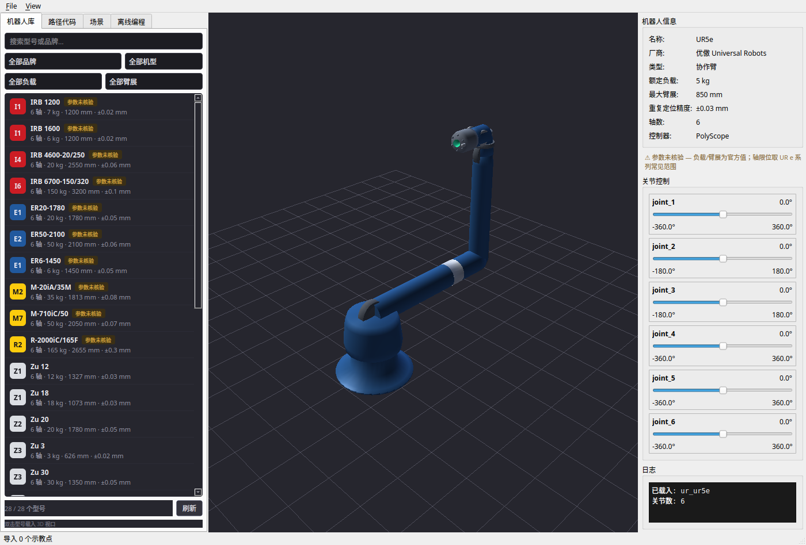
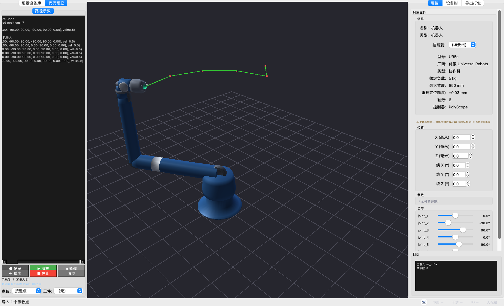
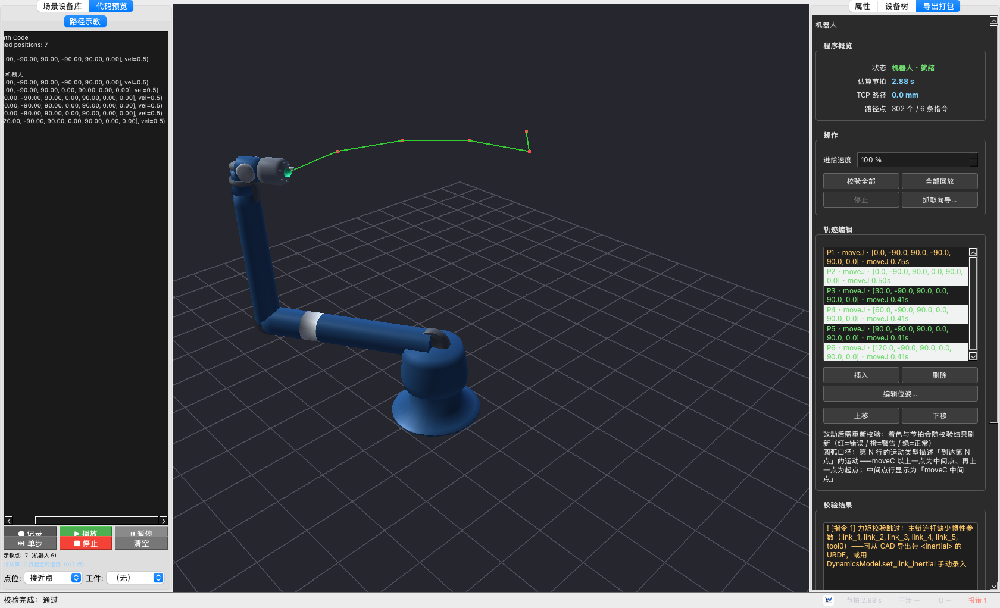
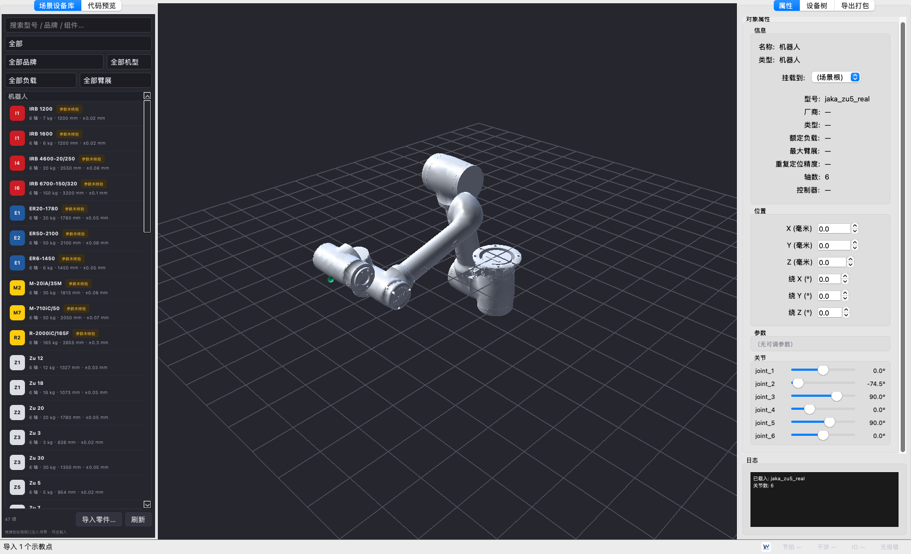

# RobotWorld

[](https://opensource.org/licenses/Apache-2.0)
[](https://python.org)
[](#development-progress)
[](#installation--quick-start)

**An open-source robot programming & simulation platform**

An open, extensible, community-driven ecosystem for industrial robotics — built on open standards (URDF), transparent algorithms, and a community-maintained post-processor library. RobotWorld goes beyond offline programming (OLP): it unifies robot modeling, trajectory planning, simulation, and code generation into one auditable toolchain, serving as a free alternative to closed ecosystems like RoboDK / Robotmaster / DELMIA.

> **Vision**: make industrial robot programming and simulation accessible to everyone by lowering the barrier of proprietary formats and closed ecosystems, while keeping the entire toolchain open and auditable end-to-end.

[🇨🇳 中文使用说明 / Chinese guide](docs/README_zh.md) · [📖 Post-processor dev guide](docs/post_dev_guide.md) · [🛠 Vendor CAD setup](docs/VENDOR_CAD_SETUP.md) · [📋 需求与计划 / PRD·Plan](docs/SPECS.md)

---

## ✨ Development Progress

Snapshot of what's actually in `main` as of the latest commit. Numbers reflect the current test suite and model library.

| Area | Status | What works today |
|---|---|---|
| **Robot model library** | ✅ 28 models | UR / KUKA / ABB / FANUC / Estun / JAKA / Huichuan; program-generated URDFs + 7 vendor-CAD JAKA models with real mesh |
| **Offline programming API** | ✅ complete | Chainable `Robot.moveJ / moveL / moveC / moveSpline`; planner expansion; cycle-time estimate; collision-aware validation |
| **Post-processors** | ✅ 7 brands | Jinja2 templates: `ur_polyscope` / `kuka_krc4` / `abb_irc5` / `fanuc_r30ib` / `estun_er` / `jaka_zu` / `huichuan_inoteach`; SPLINE auto-degrades to PTP/LIN |
| **Code upload (`link.py`)** | ✅ complete | `ControllerLink` abstraction — `FileLink` (offline export + manifest), `SimLink` (in-process kinematics echo); real controllers plug in behind the same interface |
| **Online debug (`debug.py`)** | ✅ complete | `DebugSession`: step / continuous playback, read-back actual pose, deviation vs. planned (mm + deg), jog |
| **Kinematics** | ✅ pure-Python | FK / IK / Jacobian fallback (C++ core optional); 263 unit/regression tests passing |
| **3D GUI (`rw.py`)** | ✅ complete | PySide6 + OpenGL viewport, joint sliders, robot library, path-code editor, scene & OLP panels |
| **Workcell templates** | ✅ S1 done | `orolp.world.templates`: one-call grasping workstation (UR5e + vacuum gripper w/ TCP + conveyor/bin/pallet + 4 parts); layout reach-calibrated against the shipped UR5e model (2026-09-13); loadable JSON `examples/assets/grasping_workstation.json`; demo site: `tools/build_web_site.py` → deploy/web |
| **Process IO commands** | ✅ S2 done | Chainable `setDO` / `waitDI` / `waitTime` / `gripper("open"/"close")` on Program & builder (interlocked signals + clamped feedback wait); brand IO syntax: UR `set_digital_out`, KUKA `$OUT`, ABB `SetDO`, FANUC `DO[n]=ON`; unmapped signals → visible `TODO`, never fake addresses |
| **Grasp animation (workpiece follow)** | ✅ S3 done | Program-level playback drives the scene: `orolp.world.animation` maps `gripper()` instructions onto the trajectory timeline (`GraspAnimator`); on close the workpiece attaches to the flange (world pose preserved) and follows the TCP, on open it stays where released; ProgramPanel emits gripper state changes during interpolated replay, taught PICK/PLACE points auto-insert `gripper()` into the program (replay + codegen share one definition) |
| **One-click workstation demo** | ✅ S4 done | File menu "抓取工作站演示": builds the template scene, loads UR5e into the viewport, generates an 8-point five-pick-cycle demo program via TCP-aware IK (`orolp.world.demo`, headless-testable), feeds it through the same teach-path pipeline, auto-validates (cycle time in the status bar) and auto-starts playback with workpiece attach/release |
| **Scene / collision** | 🔧 scaffold | Per-link SAT intersection available; FCL integration planned |
| **ROS 2 digital twin** | 📋 planned | Native `rclpy` bridge, target v0.3 |
| **Trajectory optimization** | 📋 planned | TOPP-RA time-optimal parameterization, target v1.0 |

---

## 🖼 Key Features Demo

The GUI is a single `rw.py` — load any URDF, switch the tab on the left, drag the joint sliders on the right.

### Main view · 3D viewport + robot library + joint control


- Left tab **机器人库** lists every model in `models/` with search and brand/payload/reach filters; click any entry to load it.
- Center is the OpenGL viewport (program-generated UR5e above, JAKA Zu5 real CAD below).
- Right panel shows robot info and six **joint sliders** with model-specific limits — drag to see live motion.

### Path-code editor · edit teach targets / generated robot code


- **路径代码** tab: text editor + Record / Play / Stop / Clear.
- Live parsing: every recognized `movej` / `movel` is visualized in the 3D viewport as a waypoint trail.

### Offline programming · program validation + cycle-time + playback


- **离线编程** tab: program summary (cycle time, TCP path, waypoint count), **校验程序 (F7)** for reachability / limits / collision, **回放** for continuous run, **停止** for interrupt.
- Coupled to the `orolp.Planner` backend — uses real kinematics, not a mock.

### Vendor CAD integration · JAKA Zu5 real machine mesh


- JAKA Zu5 loaded from `models/jaka/zu5/zu5_real.urdf` — meshes come from the **official STEP** (toolchain in `tools/build_vendor_urdf.py`, see [docs/VENDOR_CAD_SETUP.md](docs/VENDOR_CAD_SETUP.md)).
- Joint limits on the right panel match the **real Zu5 spec** (`joint_2 -85..265°`, `joint_3 ±175°`, `joint_4 -85..265°`) — not generic ±360°.
- This is the reference integration; KUKA / ABB / FANUC / Estun use the same pipeline — drop STEPs into `assets/vendor/<brand>/step/` and run the tool.

---

## 🤖 Supported robots & controllers

| Brand | Controller | Post-processor | Real-machine CAD |
|---|---|---|---|
| Universal Robots | PolyScope 5 / 6 | `ur_polyscope` | ✅ UR3 / UR5 / UR10 / UR3e / UR5e / UR10e / UR16e |
| JAKA | Zu App | `jaka_zu` | ✅ **Zu3 / Zu5 / Zu7 / Zu12 / Zu18 / Zu20 / Zu30** (vendor STEP → mesh) |
| KUKA | KRC4 | `kuka_krc4` | 🔄 pipeline ready, awaiting STEPs |
| ABB | IRC5 | `abb_rapid` | 🔄 pipeline ready, awaiting STEPs |
| FANUC | R-30iB | `fanuc_tp` | 🔄 pipeline ready, awaiting STEPs |
| Estun | ER | `estun_er` | 🔄 pipeline ready, awaiting STEPs |
| Huichuan | InoTeach | `huichuan_inoteach` | 🔄 post-processor only |

> **Adding a new brand takes < 30 min** — drop STEPs into `assets/vendor/<brand>/step/`, run `tools/build_vendor_urdf.py --brand <brand>`, then write one Jinja2 template. See [docs/post_dev_guide.md](docs/post_dev_guide.md).

---

## 🚀 Installation & Quick Start

### 1. Get the code
```bash
git clone <your-fork-url>          # the actual repo URL is provided by the maintainers
cd RobotWorld
```

### 2. Set up Python (recommended: conda)
```bash
conda create -y -n robotworld python=3.11
conda activate robotworld
```
Or use any virtualenv — Python **3.9 ~ 3.12** is supported.

### 3. Install dependencies + the `orolp` package
```bash
pip install -e ".[gui]"
```
This installs the core (numpy / scipy / jinja2 / pyyaml / pydantic) **and** the GUI (PySide6 / PyOpenGL) plus the `orolp` package itself in editable mode. No C++ build required — the pure-Python kinematics fallback is shipped and verified by the 137-test suite.

If you're behind a slow PyPI mirror:
```bash
pip config set global.index-url https://pypi.tuna.tsinghua.edu.cn/simple
```

### 4. Launch the GUI
```bash
python rw.py models/ur/ur5e/ur5e.urdf
```
- **macOS / Windows** with a desktop: window pops up directly.
- **Headless Linux** (e.g. CI / sandbox): run under `Xvfb :99 -screen 0 1600x1000x24`, then `DISPLAY=:99 python rw.py …`.

### 5. Your first program (headless / no GUI)
```python
# examples/olp_full_workflow.py — runnable end-to-end demo
from orolp import Robot, Program, Planner
from orolp.post import process as post_process
from orolp.link import FileLink, SimLink
from orolp.debug import DebugSession

robot = Robot("models/ur/ur5e/ur5e.urdf", name="UR5")
prog = (
    Program(robot)
    .moveJ([0, -1.5708, 1.5708, -1.5708, 1.5708, 0])
    .moveL_to((0.50, 0.20, 0.30, 0, 0, 0))
    .moveL_to((0.50, 0.30, 0.30, 0, 0, 0))
)
Planner().plan(prog)               # expansion + cycle-time + validation
print(post_process(prog, "ur_polyscope"))   # emit URScript

link = FileLink(out_dir="out/")    # offline export + manifest.json
prog.deploy(link, "ur_polyscope", name="pick_and_place")

# SimLink: read-back via kinematics echo (replace with ControllerLink for real hardware)
sim = SimLink(robot)
dbg = DebugSession(prog, sim)
for deviation in dbg.play():
    print(deviation)              # mm + deg vs. planned
```

---

## 🏗 Architecture

```
┌───────────────────────────────────────────────────────────────┐
│  GUI layer — rw.py (PySide6 + OpenGL)                        │
│  ──────────────────────────────────────────────────────────── │
│  MainWindow · tabs: 机器人库 / 路径代码 / 场景 / 离线编程     │
│  GLWidget viewport · joint sliders · path-code editor         │
├───────────────────────────────────────────────────────────────┤
│  Python API — `orolp` package                                 │
│  ──────────────────────────────────────────────────────────── │
│  Robot · Pose · Motion(JOINT/LINEAR/CIRCULAR/SPLINE)          │
│  Program · Planner · SimulationWorld · Link · DebugSession    │
├───────────────────────────────────────────────────────────────┤
│  Kinematics core                                              │
│  ──────────────────────────────────────────────────────────── │
│  pure-Python FK·IK·Jacobian (default, used in CI & tests)    │
│  C++ Pinocchio/FCL core (optional build via CMakeLists.txt)   │
├───────────────────────────────────────────────────────────────┤
│  Post-processor ecosystem — Jinja2 templates                  │
│  ──────────────────────────────────────────────────────────── │
│  ur_polyscope · kuka_krc4 · abb_rapid · fanuc_tp              │
│  estun_er · jaka_zu · huichuan_inoteach                        │
└───────────────────────────────────────────────────────────────┘
```

The key extensibility seams:
- **`Link` interface** — swap `FileLink` (offline) for `SimLink` (sim) or a real `ControllerLink` (e.g. RTDE / PROFINET / vendor SDK) without touching application code.
- **`_convert_motion(motion)` in each brand template** — override `_convert_spline` to keep splines when a controller supports them natively; default degrades to PTP/LIN.

---

## 🛣 Roadmap

### ✅ v0.1.0 (current — Alpha)
- [x] URDF-based unified model library (28 models, 7 brands)
- [x] Chainable motion API + planner expansion + cycle-time
- [x] 7 brand post-processors (Jinja2) with unit tests
- [x] `Link` interface + `FileLink` / `SimLink` implementations
- [x] `DebugSession`: read-back + deviation
- [x] Pure-Python kinematics fallback (FK / IK / Jacobian) — 137 tests passing
- [x] PySide6 + OpenGL terminal GUI with library / path-code / scene / OLP tabs
- [x] JAKA 7-model real-machine CAD integration via vendor STEP → mesh
- [x] Multi-brand STEP ingestion tool (`tools/build_vendor_urdf.py`)
- [x] Grasping workstation scene template (S1) + process IO commands with brand codegen (S2) — 233 tests passing
- [x] Grasp animation: workpiece follows TCP on program replay (S3) — 251 tests passing
- [x] One-click grasping-workstation demo in the GUI (S4): auto demo program via IK, cycle time + auto playback; workstation layout reach-calibrated (conveyor h=200 @ y=-400, pallet at (350, 450)) — 263 tests passing

### 🔧 v0.2.0 (Beta)
- [ ] FCL collision integration (replacing the per-link SAT scaffold)
- [ ] Linear path with IK seed / multi-solution selection
- [ ] Tool & workpiece frame calibration
- [ ] CI with real URDF regression + LFS asset caching

> Full feature roadmap with priorities, deliverables and risks: **[`docs/ROADMAP.md`](docs/ROADMAP.md)**.
>
> 单个特性的**产品需求书（PRD）**与**开发计划**见 **[`docs/SPECS.md`](docs/SPECS.md)**（文档位于 `docs/prd/`、`docs/plan/`）—— `ROADMAP` 管方向，`prd` / `plan` 管落地。

### 📋 v0.3.0 (Production candidate)
- [ ] Node-based visual programming
- [ ] ROS 2 digital-twin bridge (`rclpy`)
- [ ] Plugin marketplace

### 📋 v1.0.0
- [ ] TOPP-RA time-optimal trajectory parameterization
- [ ] Multi-robot synchronized programs
- [ ] Force-controlled process simulation
- [ ] IEC 61131-3 PLC code generation

---

## 🧪 Tests

```bash
pytest tests/ python/tests/    # 263 tests, covers kinematics / post / link / debug / vendor CAD
```
The CI workflow lives at `.github/workflows/ci.yml`.

---

## 🤝 Contributing

We welcome robot engineers, researchers, and integrators.

- **Add a brand** — easiest entry point: write one Jinja2 template + drop STEPs into `assets/vendor/<brand>/step/`. See [docs/post_dev_guide.md](docs/post_dev_guide.md).
- **Improve core algorithms** — IK solvers, path planners, calibration routines.
- **Hardware validation reports** — running a generated URScript / KRL / RAPID on a real controller.

See [CONTRIBUTING.md](CONTRIBUTING.md).

---

## 📄 License

RobotWorld is released under the **Apache License 2.0**.

Third-party robot CAD models in `models/` may carry their own licenses — see each sub-directory's `README.md`.

---

## 🙏 Acknowledgements

- [Pinocchio](https://github.com/stack-of-tasks/pinocchio) — INRIA / LAAS-CNRS
- [FCL](https://github.com/flexible-collision-library/fcl) — Flexible Collision Library
- [OMPL](https://ompl.kavrakilab.org/) — Open Motion Planning Library
- [RoboDK](https://robodk.com/) — inspiration & industry benchmark
- Every contributor who has tested on a real controller

---

**Built with ❤️ by the open-source robotics community.**