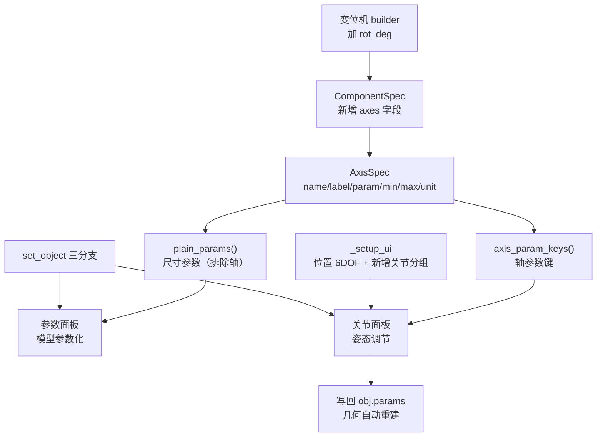

## 产品概述

解决右侧属性面板定位不清、变位机等多轴设备无法调节姿态的问题。当前变位机几何层面就没有回转自由度，且面板中缺少「关节」分组，导致设备既不能调姿态、也无从谈运动程序记录。

## 核心功能

**一、补齐设备几何自由度（阶段 1）**

- 为变位机新增回转轴：绕 Z 水平回转，行程 ±180 度
- 区分「尺寸参数」与「可动轴」两类参数，轴单独用于姿态调节
- 多轴设备可声明自己的轴列表（变位机回转轴/倾斜轴、夹爪与台钳的开合轴）

**二、右侧属性面板重构（阶段 2）**

- 明确四个面板的职责边界：
- 信息：名称、类型，机器人额外显示规格（型号/厂商/负载/臂展/精度/轴数/控制器）
- 位置：虚拟环境坐标调节，由 4 项扩到 6 项（X/Y/Z 加 绕X/绕Y/绕Z，完整位姿）
- 参数：设备模型参数化，只放尺寸参数，轴不再混在其中
- 关节：设备姿态调节，机器人显示 6 轴滑块，多轴设备显示其轴，无轴设备给出明确提示
- 修复「信息」分组大片空白

## 边界说明

- 本轮**不做**阶段 3（运动程序的录制与回放），仅让设备「能调」
- 轴值调节写回设备参数，几何随之重建，不涉及渲染管线改动

## 技术栈

- 语言与 GUI：Python 3.11 + PySide6
- 几何与场景：`domain/world/`（`components.py` 参数化组件、`geometry.py` 图元）
- 运行环境：`/opt/miniconda3/envs/robotworld/bin/python`

## 实现方案

**策略**：先在数据模型层把「可动轴」从普通尺寸参数中分离出来，再在 UI 层按职责拆分为独立分组。轴值直接写回设备参数，复用已有的参数驱动几何重建通路，无需新增渲染逻辑。

**关键技术决策**

| 决策 | 理由 |
| --- | --- |
| 新增 `AxisSpec` 与 `ComponentSpec.axes`，而非在 UI 里硬编码轴名 | 轴属于设备能力，应由组件定义自述；新增设备不需要改面板代码 |
| 轴复用已有 builder 参数（如 `tilt_deg`） | 无需改渲染与几何生成链路，写回参数即自动重建 |
| 变位机回转轴用 `tilt @ _TRz(...)` 叠加 | 与现有倾斜变换同构，先倾斜再回转，符合真实双轴变位机结构 |
| 「参数」用 `plain_params()` 过滤掉轴 | 避免同一参数在两个分组重复出现 |
| 在滚动区内部布局末尾加 `addStretch` | 修「信息」空白；此前的坑是加在外层布局导致滚动可视区被压缩，位置不同、结论相反 |


**性能与可靠性**

- 轴滑块拖动会触发参数写回与几何重建，属交互频率操作；沿用现有的按对象重建策略即可，不引入全场景重算
- 面板变高后存在被裁切风险（本项目已三次踩坑），必须实测各分组自然高度
- 风险点：`rot_deg` 为新增参数，旧场景文件中不含该键，需在取参数时回落到默认值

## 执行要点

- `_TRz` / `_TRy` 已存在（components.py 第 126、136 行），不要重复实现旋转矩阵
- `_matrix_to_rpy` 已存在（app.py 第 418 行），返回**弧度**的 (roll, pitch, yaw)，回填位置面板时需转角度
- 外层布局**不能**加 `addStretch`（会与滚动区平分高度），只能加在滚动区内部的属性布局末尾
- `_clear_params_layout` 需泛化为可清空任意布局，以同时服务「参数」与「关节」两个分组
- 改完必须三步验证：编译 → 无头探针实测 → 重启查日志

## 架构设计



## 目录结构

```
RobotWorld/
├── domain/world/components.py   # [MODIFY] 1) 新增 AxisSpec 数据类；
│                                      #          2) ComponentSpec 增加 axes 字段及
│                                      #             axis_param_keys() / plain_params()；
│                                      #          3) 两个变位机 builder 支持 rot_deg
│                                      #             并让台面随回转（tilt @ _TRz）；
│                                      #          4) 为变位机/夹爪/台钳声明 axes 与
│                                      #             rot_deg 参数
└── app.py                              # [MODIFY] DevicePropertyPanel：
                                       #          - _setup_ui：位置补 绕X/绕Y 共 6 项；
                                       #            新增「关节」分组；属性布局末尾加
                                       #            addStretch 修信息空白
                                       #          - set_object：位姿回填 6 项（用
                                       #            _matrix_to_rpy）；改为三分支
                                       #          - _on_obj_pose_edited：读全 6 项
                                       #          - _rebuild_param_rows：改用 plain_params
                                       #          - _clear_params_layout：泛化为 _clear_layout
                                       #          - 新增 _rebuild_axis_rows 与
                                       #            _on_axis_slider_changed
```

## 关键代码结构

```python
@dataclass(frozen=True)
class AxisSpec:
    """设备的一个可动轴（关节）：进「关节」面板，而非「参数」面板。"""
    name: str
    label: str        # 如 "倾斜轴"
    param: str        # 对应参数键，须已被 builder 支持
    minimum: float
    maximum: float
    unit: str = "°"
```

`ComponentSpec` 追加字段与方法：

```python
    axes: Tuple[AxisSpec, ...] = ()

    def axis_param_keys(self) -> Tuple[str, ...]:
        """所有轴对应的参数键，便于从「参数」面板中排除。"""

    def plain_params(self) -> Tuple[ParamSpec, ...]:
        """排除掉轴之后的普通尺寸参数。"""
```

`DevicePropertyPanel` 新增方法：

```python
    def _clear_layout(self, layout) -> None:
        """清空任意布局（递归处理嵌套），供「参数」与「关节」共用。"""

    def _rebuild_axis_rows(self, spec, obj) -> None:
        """为多轴设备构建「关节」滑块；无轴时显示提示文字。"""

    def _on_axis_slider_changed(self, axis, value) -> None:
        """轴值写回 obj.params，由现有通路触发几何重建。"""
```

## Agent Extensions

### Skill

- **evidence-driven-fix**
- 用途：按"先测量再判断"的方式验证本次改动。用无头 Qt 探针实测新增「关节」分组后各面板的自然高度、轴是否生成、位置面板是否 6 项，避免凭代码猜测；本项目此前已多次因面板超出可视高度被裁切
- 预期结果：编译通过；探针确认「关节」分组存在且各面板高度不超过可用高度（约 728px）；变位机能生成回转轴与倾斜轴滑块；重启后日志无异常

### SubAgent

- **code-explorer**
- 用途：核对 `components.py` 中 COMPONENTS 各条目的参数名（尤其是 `jaw_opening`、`tilt_deg`），确保 `axes` 声明的 `param` 与 builder 实际支持的参数一致
- 预期结果：得到准确的设备参数清单，避免轴声明指向不存在的参数