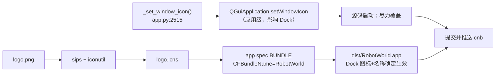

## 产品概述

RobotWorld 以源码方式 `python app.py` 启动时，macOS 把进程识别为 Python 解释器，Dock 上显示的是 python 图标、悬浮名称为 `python3.11`。需要改为显示 RobotWorld 的 logo 图标与程序名 `RobotWorld`。

## 核心功能

1. **应用级图标**：`_set_window_icon()` 在设置窗口图标的同时设置**应用级**图标，使非 bundle 进程的 Dock 图标取用 logo（仅用 Qt API，不引入 pyobjc、不做原生调用）
2. **正式 `.app` 打包**：`app.spec` 增加 macOS `BUNDLE` 段（`CFBundleName` / `CFBundleDisplayName`），并生成 `logo.icns`，使打包产物 `RobotWorld.app` 的 Dock 图标与悬浮名称由 Info.plist 确定生效
3. **同批提交**：把此前已完成并验证的界面重构改动（左侧资源库、右侧四标签、去掉场景 tab、球体组件、滚动容器）与本次图标改动一并提交并推送到 cnb

## 边界说明

- 按用户选择，本次**不安装 pyobjc、不使用 ctypes/原生 AppKit 调用**
- 因此源码启动时 Dock 图标/名称**可能不生效**（macOS 对非 bundle 进程的行为不保证）；正式 `.app` 由 `CFBundleName` 决定，是确定生效的解法
- 交付时需如实说明上述差异，不夸大运行时效果

## 技术栈

- 桌面 GUI：PySide6（`QtGui.QIcon` / `QGuiApplication.setWindowIcon`）
- 打包：PyInstaller（`app.spec`，macOS `BUNDLE` + `info_plist`）
- 图标生成：macOS 自带 `sips` + `iconutil`（无需新增依赖）
- 运行环境：`/opt/miniconda3/envs/robotworld/bin/python`

## 实现方案

**策略**：两路并行 —— 运行时用 Qt 应用级图标尽力覆盖；发布用 PyInstaller 生成正式 `.app`，由 Info.plist 保证名称与图标。

**关键技术决策与取舍**：

| 决策 | 理由 |
| --- | --- |
| 只用 `QGuiApplication.setWindowIcon` | 用户明确不装 pyobjc、不碰原生；改动最小、零依赖、零平台风险 |
| 不依赖运行时改进程名 | 用户选择 Qt-only；`setProcessName_` 属原生调用，已排除 |
| 打包段用 `BUNDLE` + `info_plist` | 这是 macOS 上 Dock 名称**唯一确定**的来源（`CFBundleName`） |
| `icon` 用 `logo.icns` 并做存在性判断 | 未生成 icns 时退化为 `None`，不阻塞 Windows 打包 |


**性能与可靠性**：图标设置只在启动期执行一次，无热路径开销；`BUNDLE` 段对 Windows 打包无影响（PyInstaller 在非 macOS 上忽略该段）。风险点为 `iconutil` 要求源图为正方形 —— 已确认 `logo.png` 为正方形且清晰度足够。

## 执行要点

- `_set_window_icon()` 现有实现只调用 `self.setWindowIcon()`，需**追加** `QtGui.QGuiApplication.setWindowIcon(icon)`，不要删原有调用（窗口标题栏图标仍需要）
- 保持 `sys._MEIPASS` 分支不变（打包后从临时目录取 logo）
- `app.spec` 现有注释写的是"用于打包 Windows 64位版本"，需同步更新为跨平台说明
- `app.spec` 第 11 行已有 `spec_dir`，第 10 行已 `import os`，`BUNDLE` 可直接复用
- 改完必须走三步验证：`py_compile` → 无头探针测布局未被裁切 → 重启查日志
- 提交前先查 `git status`：该仓库出现过 IDE 自动提交，需确认没有意外产生的提交

## 架构设计



## 目录结构

```
RobotWorld/
├── app.py                                   # [MODIFY] _set_window_icon()（约 2515 行）：在现有
│                                           #          self.setWindowIcon(icon) 之后追加
│                                           #          QtGui.QGuiApplication.setWindowIcon(icon)，
│                                           #          实现 macOS 非 bundle 进程的 Dock 图标覆盖；
│                                           #          保留 sys._MEIPASS 分支与 logo 缺失守卫
├── app.spec                                 # [MODIFY] 文件末尾新增 macOS BUNDLE 段：
│                                           #          name='RobotWorld.app'、icon='logo.icns'
│                                           #          （不存在时退化为 None）、
│                                           #          bundle_identifier='com.openrobot.work.robotworld'、
│                                           #          info_plist 含 CFBundleName / CFBundleDisplayName /
│                                           #          CFBundleShortVersionString / NSHighResolutionCapable；
│                                           #          同步更新文件头"仅 Windows"的过时注释
└── logo.icns                               # [NEW] 由 logo.png 经 sips + iconutil 生成的 macOS
                                            #       图标包；供 BUNDLE 使用，不参与 Windows 打包
```

## 关键代码结构

`app.py` — `_set_window_icon()` 目标形态（Qt-only，零原生依赖）：

```python
    def _set_window_icon(self):
        """设置窗口 / 应用程序图标。

        源码启动（python app.py）时 macOS 把进程当作 Python 解释器，Dock 显示
        python 图标与 "python3.11"。设置**应用级**图标后，非 bundle 进程的
        Dock 图标会取用该图标。Dock 名称由进程名决定，Qt 层面无法覆盖 ——
        正式发布请打包成 RobotWorld.app，由 Info.plist 的 CFBundleName 确定。
        """
        import sys
        logo_path = Path(__file__).parent / "logo.png"
        if hasattr(sys, '_MEIPASS'):
            logo_path = Path(sys._MEIPASS) / "logo.png"

        if not logo_path.exists():
            return

        icon = QtGui.QIcon(str(logo_path))
        self.setWindowIcon(icon)
        QtGui.QGuiApplication.setWindowIcon(icon)  # 应用级：影响 Dock
```

`app.spec` — 追加的 macOS 打包段：

```python
# macOS: 生成正式 .app —— Dock 名称与图标由 Info.plist + icns 确定
app = BUNDLE(
    exe,
    name='RobotWorld.app',
    icon='logo.icns' if os.path.exists(os.path.join(spec_dir, 'logo.icns')) else None,
    bundle_identifier='com.openrobot.work.robotworld',
    info_plist={
        'CFBundleName': 'RobotWorld',
        'CFBundleDisplayName': 'RobotWorld',
        'CFBundleShortVersionString': '0.2.0',
        'NSHighResolutionCapable': True,
    },
)
```

## Agent Extensions

### Skill

- **evidence-driven-fix**
- 用途：按"先测量再判断"的方式验证本次改动，用无头 Qt 探针实测面板尺寸与标签结构，避免凭代码猜测
- 预期结果：编译通过、探针确认右侧四标签与布局未被裁切、重启后日志无新增异常

### SubAgent

- **code-explorer**
- 用途：提交前核对 `git status` 与是否存在 IDE 自动产生的提交，确认待提交文件清单准确
- 预期结果：得到准确的待提交文件列表，避免误提交或漏提交