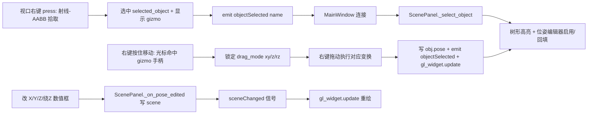

## 用户需求

在 RobotWorld 的 3D 视口（GLWidget）中为工作单元场景对象（工作台、控制柜、机器人底座等）增加直观的「右键拾取 + 坐标系 gizmo 拖拽」交互，并与左侧「选中对象位姿」编辑器实时双向同步。

## 产品概述

当前左侧 ScenePanel 的树形列表点击可选中对象并编辑位姿，但 3D 视口仅支持左键旋转视角与滚轮缩放，右键无任何拾取逻辑。需在视口补齐「右键点选对象 → 弹出坐标系 gizmo → 光标移到手柄选定操作模式 → 按住右键拖动执行 → 数值框双向同步」的完整交互闭环。

## 核心功能

- 右键点选：在视口右键点击对象，按相机参数反推射线，对场景对象做包围盒求交，选中最近对象并在视口描边高亮。
- 坐标系 gizmo：选中后对象原点处绘制三个手柄——XY 移动平面（蓝绿半透明）、Z 移动轴（红）、绕 Z 旋转环（黄），始终朝向相机对齐，便于辨识。
- 模式选择：右键按住后移动光标，射线命中哪个手柄即高亮该手柄并锁定为该次拖动的模式（xy / z / rz）。
- 拖动执行：按住右键拖动分别实现——XY 面拖动改 X/Y；Z 轴拖动改 Z 高度；旋转环拖动改绕 Z 角度。
- 双向同步：视口拖动时左侧 X/Y/Z/绕Z 数值框实时刷新；在数值框改值视口实时重绘。
- 视角不变：左键继续用于旋转视角，与右键拖动互不干扰。

## 技术栈

- GUI：PySide6（`QOpenGLWidget` / 信号槽 / 鼠标事件）
- 数值与几何：numpy；复用现有 `domain.world.geometry.prim_aabb`（基本体世界 AABB，毫米）
- 场景数据：`domain.world.scene.Scene.object_parts(name)`（世界系 Part 列表，毫米）、`Scene.world_transform(name)`（含父级链）
- 位姿：`domain.pose.Pose.from_xyz_rpy(x, y, z, roll, pitch, yaw)` 与 `Pose.matrix`

## 实现方案

### 总体策略

在 `GLWidget` 内新增「右键 → 射线拾取选中 → 绘制坐标系 gizmo → 光标命中手柄选定模式 → 右键拖动执行 → 发射选中信号」链路，完全复用 `paintGL` 已构造的相机模型与现有 `geometry.prim_aabb`、`Pose` API。主窗口把 `objectSelected` 信号接到 `ScenePanel._select_object`，直接复用现有位姿回填与数值编辑逻辑，不改动 `ScenePanel` 公共 API。

### 关键技术决策

1. **射线反推（`_ray_from_mouse`）**：用与 `paintGL` 一致的相机公式重建 `eye` 与 lookAt 基、`fov=45`、near=0.01、far=100 的 frustum 投影矩阵，由鼠标 NDC 经 `(P·V)⁻¹` unproject 出近/远平面世界点；射线原点=eye，方向=远点-eye。全程米制（相机全为米）。
2. **拾取（`_pick_object`）**：遍历 `scene.objects`，对每个对象用 `object_parts` + `prim_aabb` 合并出米制 AABB，对所有对象做射线-AABB slab 求交，取 `t>0` 最小者；无命中返回 `None`。理由：AABB 粗筛对参数化基本体足够精确，零新增依赖、O(对象数×零件数) 极低开销，仅右键事件触发。
3. **坐标系 gizmo（`_draw_gizmo` / `_gizmo_hit_mode`）**：在对象世界原点（米）绘制三个手柄，始终基于相机基对齐（Z 轴取世界 +Z，XY 面为对象局部 XY，旋转环绕 Z）。`_gizmo_hit_mode` 在屏幕空间判定光标落在哪个手柄：Z 轴看点到竖直线距离、旋转环看点到环半径差、XY 面看是否在方形/圆盘内，返回 `"xy"/"z"/"rz"/None`。`drag_mode` 选定后对应手柄加亮加粗。
4. **交互链路（鼠标事件）**：

- `mousePressEvent`：右键先 `_pick_object`；命中则 `selected_object=name`、记录 `gizmo_center_m`、初始 `drag_mode=None`、`emit objectSelected(name)`、`self.update()` 显示 gizmo；未命中清除选择。左键保持原相机拖拽。
- `mouseMoveEvent`：若 `buttons() & RightButton` 且 `selected_object` 有效：`drag_mode is None` 时用 `_gizmo_hit_mode` 探测并预览高亮；选定后执行——`"xy"` 取射线 ∩ 平面 Z=对象世界Z 的 Δ 平移（米→mm 加到 X/Y，保持绕Z）；`"z"` 取射线 ∩ 过对象原点的竖直线求新 Z；`"rz"` 取光标绕 `gizmo_center_m` 屏幕投影中心的角度设绕Z。写 `obj.pose`（有父级经父世界逆矩阵换算回局部），`self.update()`，`emit objectSelected(name)` 刷新数值框。左键 dragging 仍走相机旋转。

5. **双向同步**：拖动每帧 `emit objectSelected(name)` → `ScenePanel._select_object` → `_on_tree_selected`（带 `_updating` 防回环）回填 X/Y/Z/绕Z spin；数值框改动经 `_on_pose_edited` 写 `scene` 并发 `sceneChanged`，主窗口已连接 `sceneChanged → gl_widget.update`，链路天然闭环。
6. **高亮**：`paintGL` 对 `selected_object` 复用 `_highlight_object` 的红色线框描边（独立标志位，不新增绘制类型）。

### 性能与可靠性

- 拾取/命中/拖动仅在右键事件触发，非逐帧，开销可忽略。
- 单位统一：场景/几何毫米、视口米，统一用 `MM_TO_M=0.001` 换算，避免错位。
- 容错：`scene` 为 None / 无对象 / 未命中时安全返回不报错；`prim_aabb` 已覆盖 box/cylinder/sphere。
- 拖动用「起点记录 + 增量」方式，避免逐帧从世界变换重算导致二次叠加误差。

## 架构设计



## 目录结构

```
/Users/jayhan/RobotWorld/
└── olp.py   # [MODIFY] 视口 GLWidget：新增 objectSelected 信号、_ray_from_mouse /
             #          _ray_plane_z / _project 辅助方法、_pick_object 拾取；
             #          新增 _draw_gizmo / _gizmo_hit_mode；mousePressEvent 增加
             #          Qt.RightButton 选中并显 gizmo；mouseMoveEvent 增加右键
             #          拖动按模式改 X/Y/Z/绕Z 并双向同步；paintGL 对
             #          selected_object 描边高亮。主窗口 setup_ui 连接
             #          objectSelected → scene_panel._select_object。
```

## 关键代码结构

```python
class GLWidget(QtOpenGLWidgets.QOpenGLWidget):
    objectSelected = QtCore.Signal(str)   # 右键拾取/拖动时发射对象名（未命中不发射）

    def _ray_from_mouse(self, x: int, y: int) -> Tuple[np.ndarray, np.ndarray]:
        """返回 (origin_m, dir_m)：世界系米制射线原点与单位方向。"""

    def _ray_plane_z(self, origin_m, dir_m, z_m) -> Optional[np.ndarray]:
        """射线与水平面 z=z_m 的交点（米）；平行或无交点返回 None。"""

    def _project(self, p_m: np.ndarray) -> Tuple[float, float]:
        """世界点（米）投影到视口像素坐标，供 gizmo 命中/绘制。"""

    def _pick_object(self, x: int, y: int) -> Optional[str]:
        """射线-AABB 求交，返回最近场景对象名；无命中返回 None。"""

    def _draw_gizmo(self) -> None:
        """在 selected_object 原点绘制 XY 面 / Z 轴 / 绕Z 环手柄，高亮当前 drag_mode。"""

    def _gizmo_hit_mode(self, x: int, y: int) -> Optional[str]:
        """屏幕空间判定光标命中的手柄，返回 'xy' / 'z' / 'rz' / None。"""
```